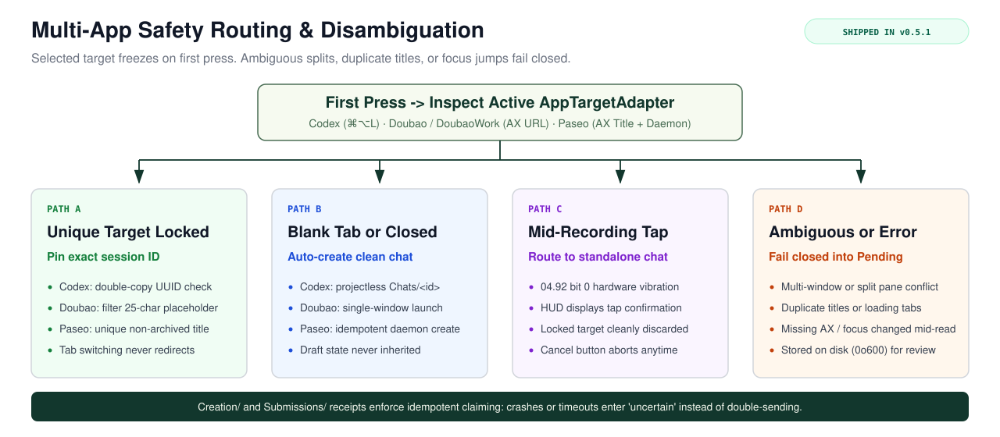
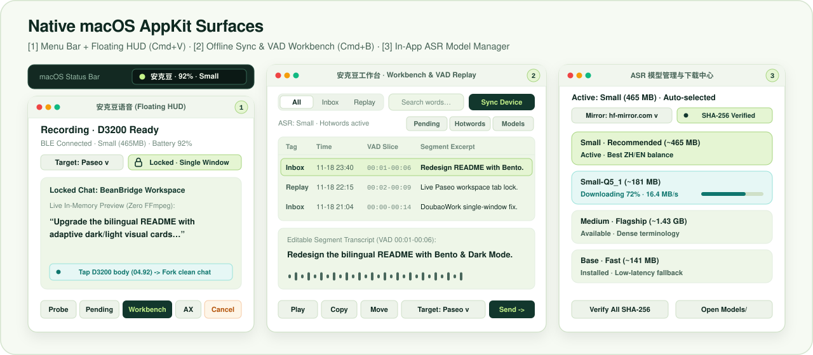
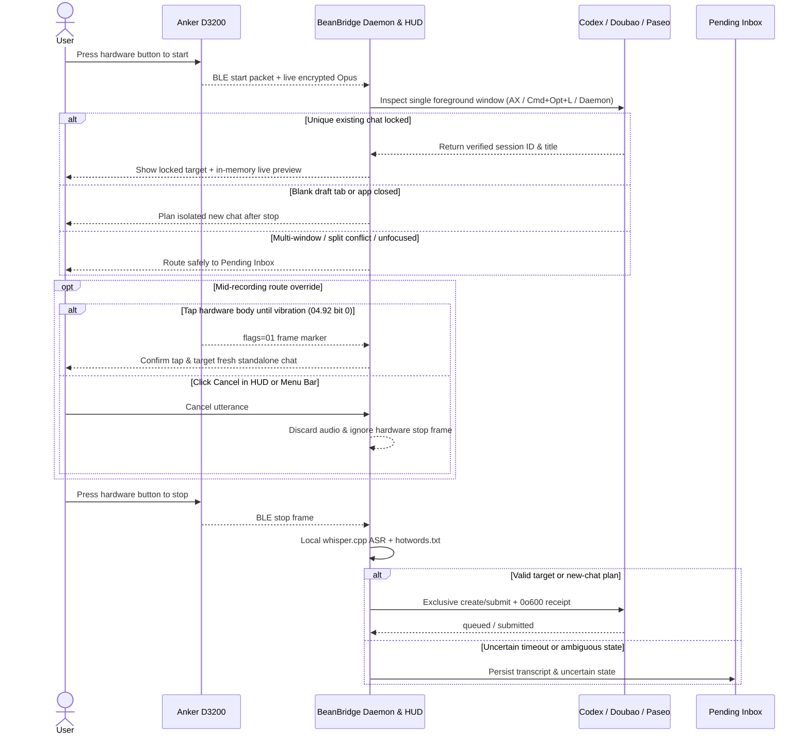
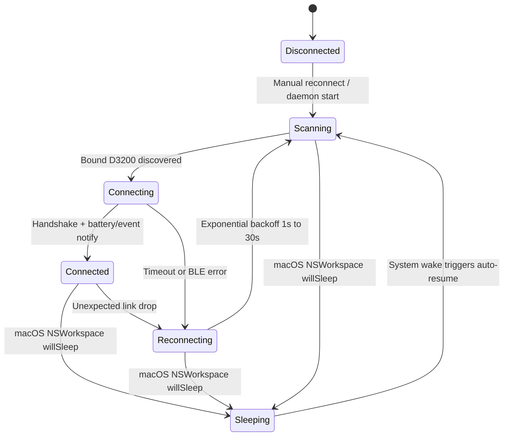

<a id="top"></a>

<p align="center">
  
</p>

<h1 align="center">BeanBridge · 豆桥</h1>

<p align="center">Turn your soundcore Work / Anker D3200 wearable AI recorder into a physical macOS voice capture button &amp; workbench for <b>Codex · Doubao · Paseo</b>.</p>

<p align="center"><b>Press to speak · Live in-memory preview · Tap to fork a new chat · Press again to deliver safely</b></p>

<p align="center">
  <a href="README.md">简体中文</a> · <b>English</b>
</p>

<p align="center">
  <code>macOS 14+</code> ·
  <code>Swift 5.10</code> ·
  <code>whisper.cpp</code> ·
  <code>Targets: Codex | Doubao | Paseo</code> ·
  <code>Tests: 49 Swift + 16 Python</code> ·
  <code>Apache-2.0</code>
</p>

<p align="center">
  <a href="#architecture--data-flow">Architecture</a> ·
  <a href="#desktop-ui-tour">UI Tour</a> ·
  <a href="#supported-apps--client-guides">Client Guides</a> ·
  <a href="#quick-start">Quick Start</a> ·
  <a href="#button-interaction--ble-state-machine">Sequences &amp; BLE</a> ·
  <a href="#workbench--model-manager">Workbench &amp; Models</a> ·
  <a href="#interactive-troubleshooting-faq">FAQ</a> ·
  <a href="#verification-status--known-boundaries">Verification</a>
</p>

---

**BeanBridge** maintains a persistent Bluetooth Low Energy (BLE) connection to the Anker D3200 wearable recorder on macOS. It decrypts live Opus streams in memory, runs local speech-to-text with `whisper.cpp`, and safely routes verified final transcripts to your locked foreground AI chat via macOS Accessibility and per-app adapters. It also provides an **always-on menu bar daemon**, an **in-app ASR Model Manager**, **BLE auto-reconnect & sleep/wake recovery**, and a **Workbench panel** for incremental offline sync, VAD segmentation, and segment replay.

## Key Capabilities

- **Pluggable Multi-App Routing (Codex / Doubao / Paseo)**: Unified `AppTargetAdapter` protocol and `AppTargetRegistry`. Switch the default target anytime from the menu bar, HUD, or Workbench—or add new desktop AI clients cleanly.
- **First-Press Foreground Lock & Fail-Closed Guard**: Freezes your foreground single conversation window on first press so mid-recording tab switches never misroute text. Multi-window clutter, split panes, duplicate workspace tab titles, focus shifts, or missing permissions always fall back cleanly to the disk-backed **Pending Inbox (`0o600`)**—never guessing a destination. Includes an in-recording **Cancel (`取消本条`)** action.
- **High-Accuracy Local ASR & In-App Download Center**: Supports 4 verified `whisper.cpp` GGML tiers (`base` / `small-q5_1` / `small` / `medium`), an in-app downloader supporting **Hugging Face Official** and **HF Mirror (`hf-mirror.com`)** with background continuation and streaming SHA-256 verification, customizable `hotwords.txt`, and zero-`ffmpeg` 48kHz→16kHz in-memory live previews.
- **BLE Resilience & Offline Inspiration Workbench**: Runs quietly via `NSStatusItem` (`LSUIElement=true`) even when the HUD closes. `ReconnectCoordinator` handles `1s`–`30s` exponential backoff and macOS `NSWorkspace` sleep/wake awareness. `WorkbenchPanel` enables incremental offline sync, energy-based VAD slicing, multi-keyword search, segment playback, and one-click forwarding.

## Architecture & Data Flow

<p align="center">
   In-memory decode & ASR -> Multi-App Safety Router" width="100%" />
</p>

> [!IMPORTANT]
> **Immutable Lock Rule**: The delivery target is locked on your **first hardware button press** and shown immediately in the HUD. Switching windows afterward will not redirect this recording; if ambiguity or duplicate tabs occur, BeanBridge preserves your text in `Pending/` rather than guessing a recent thread.

<details>
<summary><b>Expand Diagram: Multi-App Safety Routing &amp; Disambiguation (Paths A–D)</b></summary>

<p align="center">
  
</p>

</details>

<details>
<summary><b>Expand Diagram: Background Daemon, Model Center &amp; Offline Workbench Pipeline</b></summary>

<p align="center">
  
</p>

</details>

<p align="right"><a href="#top">↑ Back to Top</a></p>

## Desktop UI Tour

Built purely with native macOS AppKit—featuring a menu bar status item plus three coordinated panels while avoiding Electron overhead:

<p align="center">
  
</p>

<details>
<summary><b>Expand Guide: Controls &amp; Keyboard Shortcuts Reference</b></summary>

| Surface / Shortcut | Purpose &amp; Key Actions |
|---|---|
| **Menu Bar Item (`NSStatusItem`)** | Displays live connection, battery &amp; status (`🎙️ 安克豆 92%`, `🔴 录音中`, `🔄 重连#2`, `🌙 休眠`), active Whisper model, and background download progress |
| <kbd>⌘</kbd>+<kbd>V</kbd> **Floating HUD (`安克豆语音`)** | Switch default target app, monitor live in-memory ASR preview, view locked chat badge, and run **Probe (`检测目标`)**, **AX Auth**, or **Cancel (`取消本条`)** |
| <kbd>⌘</kbd>+<kbd>B</kbd> **Workbench (`WorkbenchPanel`)** | Incremental offline sync (`增量同步离机录音`), filter by All / Inspiration Inbox / Work Replay, multi-keyword search, play VAD audio slices, edit transcript, and send to active or new sessions |
| <kbd>⌘</kbd>+<kbd>P</kbd> **Pending Inbox (`待发箱`)** | Inspect utterances preserved due to focus/permission/ambiguity guards; paste an explicit chat link to deliver or trigger standalone session creation |
| **ASR Model Manager (`ASRModelManagerWindow`)** | Open via menu bar or Workbench; switch between **HF Official** and **`hf-mirror.com`**, monitor speed/ETA, resume downloads when closed, and batch-verify SHA-256 |
| **Additional Shortcuts** | <kbd>⌘</kbd>+<kbd>R</kbd> Reconnect Now · <kbd>⌘</kbd>+<kbd>Q</kbd> Quit |

</details>

<p align="right"><a href="#top">↑ Back to Top</a></p>

## Supported Apps & Client Guides

| `appID` | Client(s) &amp; Bundle ID(s) | Foreground Detection &amp; Lock | Creation &amp; Delivery | Current Verification Status |
|---|---|---|---|---|
| `codex` | **Codex** (`com.openai.codex`) | Triggers `⌘⌥L` deep-link copy with dual-sample consistency + read-only `thread/read` | Creates isolated projectless `Chats/<id>` session; queues via `codex queue --thread` | **Physical D3200 E2E verified** (lock, cold start, tap-to-new-chat delivered &amp; replied) |
| `doubao` | **Doubao / DoubaoWork** (`com.work.pc.doubao` / `com.bot.pc.doubao` / `com.bytedance.doubao`) | Reads document/window URL via AX (`chrome://doubaowork-chat/chat` mapped), filters built-in 25-char empty placeholder while keeping real user drafts | `scripts/doubao-chat.py` exclusive receipts + single-window launch &amp; AX submission | **Verified on live `DoubaoWork.app`** (probe, single-window launch &amp; empty-box send passed) |
| `paseo` | **Paseo** (`sh.paseo.desktop`) | Parses `/agent/<id>` directly; on `/workspace/<id>` enables `AXEnhancedUserInterface` and pairs `kAXTitleAttribute` with `resolve-workspace-tab` daemon matching | `scripts/paseo-chat.py` + `paseo-daemon-helper.mjs` idempotent create + `paseo send --behavior steer` | **Physical D3200 E2E verified on maximized workspace** (locks &amp; delivers live to active session; draft create &amp; tap pending live test) |

<details>
<summary><b>Choose Your Setup Path (Click to Expand Codex / DoubaoWork / Paseo Notes)</b></summary>

#### 1. Using Codex Desktop
- Ensure desktop Codex is signed in (uses built-in `CodexCLI.app` or `codex` on `PATH`; override with `BEANBRIDGE_CODEX`).
- Keep default `⌘⌥L` Copy Chat Deep Link enabled (if customized, override macOS virtual keycode via `BEANBRIDGE_COPY_KEYCODE`, default `37` = `L`).
- Leave one Codex window in the foreground when pressing the D3200 button; blank pages or closed Codex automatically spawn a clean standalone session upon finish.

#### 2. Using Doubao / DoubaoWork (`com.work.pc.doubao`)
- Supports consumer Doubao and enterprise `DoubaoWork.app` (override priority order with comma-separated `BEANBRIDGE_DOUBAO_BUNDLE_ID`).
- Built-in filter (`CurrentChat.isDoubaoPlaceholderOrEmpty`) distinguishes DoubaoWork's built-in 25-char empty input prompt hint from real user drafts so empty chats deliver cleanly without overwriting genuine typed drafts.
- Optional overrides: `BEANBRIDGE_DOUBAO_BRIDGE_CMD` (custom submission bridge) or `BEANBRIDGE_DOUBAO_AX_SUBMIT=0` (disable built-in AX submit).

#### 3. Using Paseo (`sh.paseo.desktop`)
- Supports standalone agent routes (`paseo://h/<serverId>/agent/<id>` / `https://app.paseo.sh/h/<serverId>/agent/<id>`) as well as maximized/fullscreen workspace views (`/h/<serverId>/workspace/<workspaceId>`).
- Filters macOS fullscreen auxiliary strips automatically and uses `kAXTitleAttribute` + `resolve-workspace-tab` against the local Paseo daemon to pinpoint the unique non-archived agent in that workspace.
- **Fail-Closed Safety**: `"新建 Agent"` / `"New Agent"` / `"New tab"` draft pages automatically trigger new-session creation after speech finishes; duplicate agent titles, loading placeholders, or multi-agent split panes fail closed into `Pending` rather than guessing.
- Optional overrides: `BEANBRIDGE_PASEO_PROVIDER`, `BEANBRIDGE_PASEO_WORKSPACE_ID`, `BEANBRIDGE_PASEO_CWD`, `BEANBRIDGE_PASEO_CLI`.

</details>

<p align="right"><a href="#top">↑ Back to Top</a></p>

## Quick Start

### Step 1: Prerequisites & Clone

```bash
git clone https://github.com/sup-lh/beanbridge.git
cd beanbridge
brew install whisper.cpp
```

> Tested primarily on Apple Silicon, macOS 26.6.2, Xcode 26.2 / Swift 5.10, `whisper.cpp` 1.9.5 (minimum package deployment target macOS 14+). Live preview resampling runs completely in memory—`ffmpeg` is optional for button usage.

### Step 2: Install a Local Speech Model (In-App or CLI)

- **Option A (Recommended — In-App Download Center)**: Skip directly to Step 3, launch the app, and open **「ASR 模型管理与下载…」** from the menu bar (or **「ASR 模型与下载」** in the Workbench) to pick **Hugging Face Official** or **`hf-mirror.com`** with live progress and streaming SHA-256 verification.
- **Option B (CLI Pre-install)**:

```bash
./scripts/setup-model.sh --tier small-q5_1 --set-default
# Default without flags downloads lightweight ggml-base.bin. Tiers: base | small-q5_1 | small | medium
```

<details>
<summary><b>Expand Table: 4 Whisper GGML Tiers &amp; Resolution Priority</b></summary>

| Tier (`--tier`) | File | Approx. Size | Best For |
|---|---|---|---|
| `base` | `ggml-base.bin` | ~141 MiB | Lowest latency fallback baseline |
| `small-q5_1` | `ggml-small-q5_1.bin` | ~181 MiB | Balanced speed &amp; quantized EN/ZH accuracy |
| `small` | `ggml-small.bin` | ~465 MiB | **Recommended daily driver** for Chinese &amp; bilingual dictation |
| `medium` | `ggml-medium.bin` | ~1.43 GiB | Flagship accuracy for dense terminology; higher CPU/disk usage |

Resolution order: `BEANBRIDGE_MODEL` env var ＞ `support/model-preference` ＞ auto-discovery (`medium > small > small-q5_1 > base`) ＞ fallback `Models/ggml-base.bin`.

</details>

### Step 3: Build, Launch & Grant macOS Permissions

```bash
./build-button-app.sh
open "dist/安克豆按键语音.app"
# Or double-click `启动按键语音.command` in the repository root
```

1. **Free the D3200 BLE Link**: Disable Bluetooth on your iPhone temporarily (or make sure mobile Feishu/Lark isn't connected to the D3200) and keep the recorder idle nearby.
2. **Grant Bluetooth & Accessibility**:
   - Allow **Bluetooth** access when prompted (check *System Settings → Privacy & Security → Bluetooth*).
   - Click **「辅助功能授权」** in the HUD and enable **安克豆按键语音** under *System Settings → Privacy & Security → Accessibility*.

> [!TIP]
> **Missing Accessibility after rebuilding?** `./build-button-app.sh` ad-hoc signs the bundle (`codesign --sign -`), which invalidates previous macOS TCC entries. Reset Accessibility cleanly and re-toggle once:
> ```bash
> tccutil reset Accessibility dev.codex.anker-button-voice
> ```

### Step 4: Select Target & Speak

1. Select `Codex`, `豆包`, or `Paseo` in the HUD dropdown, menu bar submenu, or Workbench.
2. Click **「检测目标」** (switch back to your target window within 3 seconds)—reads target safely without sending anything.
3. **Press D3200 once to speak → Watch live HUD preview → Press once more to deliver** (or tap the hardware mid-recording to fork a fresh session).

<p align="right"><a href="#top">↑ Back to Top</a></p>

## Button Interaction & BLE State Machine

Both Mermaid diagrams below support GitHub's built-in interactive zoom/pan controls:



<details>
<summary><b>Expand Diagram: BLE Auto-Reconnect &amp; Sleep/Wake Lifecycle (ReconnectCoordinator)</b></summary>



</details>

## Workbench & Model Manager

- **BeanBridge Workbench (`WorkbenchPanel`)**:
  - **Incremental Offline Sync**: Syncs offline hardware recordings via `Workbench/sync-manifest.json` without duplicating already archived files.
  - **VAD Slicing & Multi-Keyword Search**: Automatically detects speech boundaries (`AudioVADslicer`) with millisecond intervals; filter by All / Inspiration Inbox / Work Replay and search using space-separated terms.
  - **Audition, Edit & Forward**: Play back individual VAD slices, refine text inline, copy to clipboard, or forward directly to `Codex` / `Doubao` / `Paseo` (existing or standalone new session).
- **Custom Hotwords (`HotwordManager`)**: Stored in `~/Library/Application Support/AnkerVoiceBridge/hotwords.txt` (pre-seeded with terms like `安克豆`, `BeanBridge`, `Codex`, `豆包`, `Doubao`, `飞书`, `Whisper`, `Agent`, `Swift`, `Python`) and editable anytime in-app.

<details>
<summary><b>Expand Reference: Dry-Run, Fixed Mode, BlackHole Mic, Local Paths &amp; Env Overrides</b></summary>

### Transcribe Only Without Delivering (`dry-run`)

```bash
touch "$HOME/Library/Application Support/AnkerVoiceBridge/dry-run"
open "dist/安克豆按键语音.app"
# Delete dry-run and relaunch to re-enable delivery
```

### Legacy Fixed Codex Target Binding

```bash
python3 scripts/set-target.py --thread-id "<TARGET_UUID>"
printf 'fixed\n' > "$HOME/Library/Application Support/AnkerVoiceBridge/routing-mode"
# Delete routing-mode or set "current" to return to foreground locking; --check validates read-only
```

### BlackHole Virtual Microphone Bridge

```bash
brew install blackhole-2ch
swift build -c release --product anker-voice-bridge
.build/release/anker-voice-bridge
# Do not run alongside 安克豆按键语音.app; Ctrl-C exits & restores prior system input (1h limit)
```

### Local Support Directory &amp; Environment Overrides

`~/Library/Application Support/AnkerVoiceBridge/` (`0o700` dirs / `0o600` sensitive files):
- `target-app`, `model-preference`, `hotwords.txt`
- `Models/`, `Pending/`, `Creation/`, `Submissions/`, `Workbench/`, `Chats/`, `PaseoVoice/`

Environment overrides (effective when launched from the same shell):
- Routing: `BEANBRIDGE_TARGET_APP`, `BEANBRIDGE_ROUTING`, `BEANBRIDGE_COPY_KEYCODE`, `BEANBRIDGE_SCRIPTS_DIR`
- Codex: `BEANBRIDGE_CODEX`, `BEANBRIDGE_CODEX_BUNDLE_ID`
- Doubao: `BEANBRIDGE_DOUBAO_BUNDLE_ID`, `BEANBRIDGE_DOUBAO_BRIDGE_CMD`, `BEANBRIDGE_DOUBAO_AX_SUBMIT`, `BEANBRIDGE_DOUBAO_DIAG=1`
- Paseo: `BEANBRIDGE_PASEO_BUNDLE_ID`, `BEANBRIDGE_PASEO_CLI`, `BEANBRIDGE_PASEO_APP`, `BEANBRIDGE_PASEO_HOST`, `BEANBRIDGE_PASEO_HOME`, `BEANBRIDGE_PASEO_PROVIDER`, `BEANBRIDGE_PASEO_CWD`, `BEANBRIDGE_PASEO_WORKSPACE_ID`, `BEANBRIDGE_PASEO_DIAG=1`
- ASR &amp; Tools: `BEANBRIDGE_MODEL`, `BEANBRIDGE_MODEL_BASE_URL`, `BEANBRIDGE_WHISPER`, `BEANBRIDGE_WHISPER_NO_GPU=1`, `BEANBRIDGE_FFMPEG`, `BEANBRIDGE_PYTHON`

</details>

<p align="right"><a href="#top">↑ Back to Top</a></p>

## Interactive Troubleshooting FAQ

<details>
<summary><b>Q1: Accessibility is enabled in System Settings, why does Target Probe still say permission denied?</b></summary>

Ad-hoc rebuilding via `./build-button-app.sh` changes the app code signature, invalidating prior TCC approval. Run:
```bash
tccutil reset Accessibility dev.codex.anker-button-voice
```
Then relaunch `dist/安克豆按键语音.app` and re-enable it under *System Settings → Privacy & Security → Accessibility*.

</details>

<details>
<summary><b>Q2: Maximized Paseo reports "No target", or how does it handle duplicate tab titles?</b></summary>

- If the active Paseo tab is a blank draft (**"新建 Agent" / "New tab"**), read-only probing intentionally reports no target because no session ID exists yet—holding D3200 to speak will automatically create an isolated session in that workspace and deliver it.
- If multiple non-archived agents share an identical title in the same workspace or a split view shows multiple agents, BeanBridge intentionally fails closed into `Pending` instead of guessing. Rename one tab uniquely or inspect `~/Library/Application Support/AnkerVoiceBridge/paseo-ax-diag.json`.

</details>

<details>
<summary><b>Q3: Why did DoubaoWork previously pop two windows or mistake an empty input for a draft?</b></summary>

Both are fixed in `0.5.1`: cold starts/new sessions launch `com.work.pc.doubao` cleanly without passing `doubaowork://` URLs that opened `DoubaoWork Browser.app`, and `CurrentChat.isDoubaoPlaceholderOrEmpty` filters DoubaoWork's 25-character built-in hint string while still guarding real user-typed drafts.

</details>

<details>
<summary><b>Q4: How can I improve recognition on mixed Chinese/English or technical terms like README and Paseo?</b></summary>

1. Open **ASR 模型管理与下载…** from the menu bar and switch to **`Small` (~465MB)** or **`Small-Q5_1` (~181MB)**.
2. Click **编辑专业术语热词表…** to add project jargon and English identifiers to `hotwords.txt`.

</details>

<details>
<summary><b>Q5: Phone Feishu/Lark steals the D3200 BLE connection, or connection stays idle after sleep?</b></summary>

Toggle iPhone Bluetooth off briefly so the recorder disconnects from mobile, and wait for `ReconnectCoordinator` (`1s`–`30s` backoff upon Mac wake) or press <kbd>⌘</kbd>+<kbd>R</kbd> from the menu bar.

</details>

<p align="right"><a href="#top">↑ Back to Top</a></p>

## Verification Status & Known Boundaries

| Area | Verification Method | Status &amp; Boundaries |
|---|---|---|
| D3200 BLE discovery, live Opus decrypt &amp; BlackHole mic bridge | Physical D3200 hardware | **Verified live** |
| Codex foreground lock, tab-switch guard, cold start &amp; `04.92` tap-to-new-chat | Physical D3200 E2E | **Verified live** (confirmed delivered &amp; replied) |
| `DoubaoWork.app` probing, single-window launch &amp; empty placeholder handling | Live local `DoubaoWork.app` | **Verified on desktop client** |
| Paseo maximized workspace current-session lock &amp; D3200 button delivery | Physical D3200 + live `Paseo.app` E2E | **Verified live** (multiple messages delivered to active session; draft auto-create &amp; mid-recording tap pending live test) |
| In-app ASR Model Manager (`ggml-small.bin` 465 MB download &amp; SHA-256 verify) | Live `.app` UI + unit tests | **Verified live &amp; automated** |
| BLE reconnect backoff, sleep/wake recovery, incremental offline sync &amp; VAD archive | Swift / Python suites + Release build | **49 Swift XCTests + 16 Python unittests + `verify-release.sh` PASS**; **full-day sleep endurance &amp; large offline hardware backlog remain untested on hardware** |

> [!NOTE]
> A `queued` delivery status confirms handoff to the target CLI or daemon; actual visibility in the chat window remains the source of truth. Raw recordings and private chats are never committed to Git.

## Development, Tests & Repository Layout

```bash
swift build -c release
swift test
/usr/bin/python3 -m unittest scripts/test-create-chat.py scripts/test-doubao-chat.py scripts/test-paseo-chat.py
./scripts/verify-release.sh
```

```text
Sources/AnkerButtonVoice/    Menu bar daemon, floating HUD, ASRService/hotwords, Model Manager UI, Workbench UI
Sources/AnkerVoiceBridge/    BlackHole virtual mic audio bridge & system input save/restore
Sources/AnkerEventProbe/     Read-only BLE control packet & 04.92 tap flag diagnostic CLI
Sources/OpenBeanKit/         OpenBean-derived BLE/Opus core, ASRModelCatalog, ReconnectCoordinator, WorkbenchSync
Sources/VoiceRouting/        AppTargetAdapter protocol, Codex/Doubao/Paseo adapters, AX inspection, PendingStore
scripts/                    Model setup, Codex/Doubao/Paseo bridges & daemon helper, 16 Python tests, release check
Tests/                      OpenBeanKitTests & VoiceRoutingTests (49 Swift XCTests)
docs/                       Field notes, routing design, brand assets & roadmap (in Chinese)
```

## Attribution & License

- Core BLE device protocol & portions of `OpenBeanKit` are adapted from [OpenBean](https://github.com/imraywang/openbean) (baseline commit `13968d8ea27ca57fa254bf01c43c13c388f1a696`); see [docs/third-party.md](docs/third-party.md) and [NOTICE-OpenBean](NOTICE-OpenBean).
- Code, documentation, and original visual assets in this repository are licensed under [Apache-2.0](LICENSE); external dependencies (`whisper.cpp`, BlackHole, GGML models) follow their own licenses. Not officially affiliated with Anker, Feishu/Lark, OpenAI, ByteDance/Doubao, or Paseo.

<p align="right"><a href="#top">↑ Back to Top</a></p>
