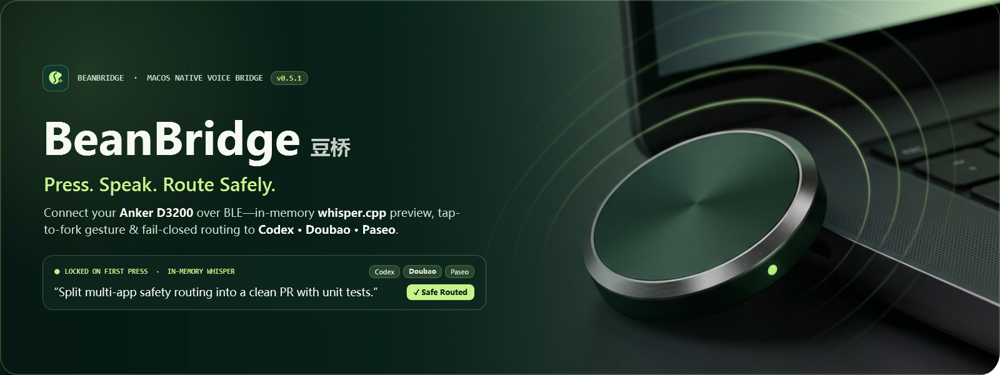
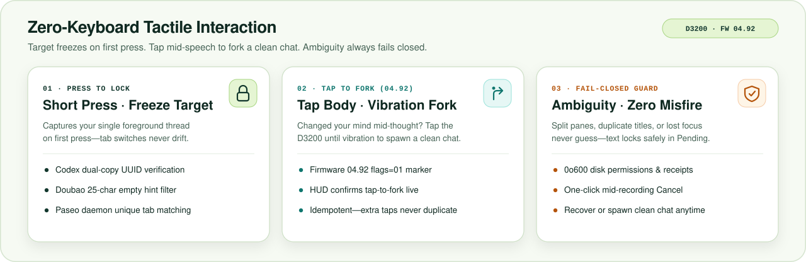
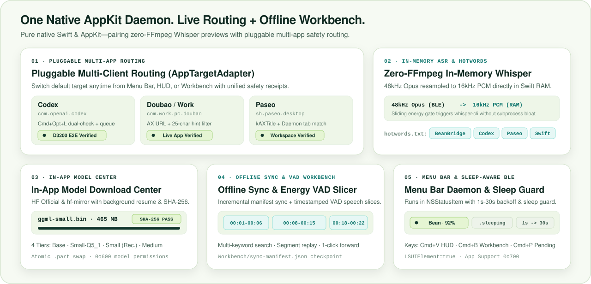
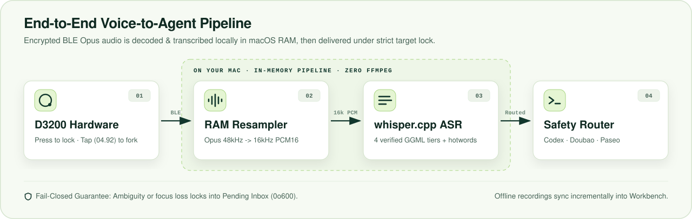
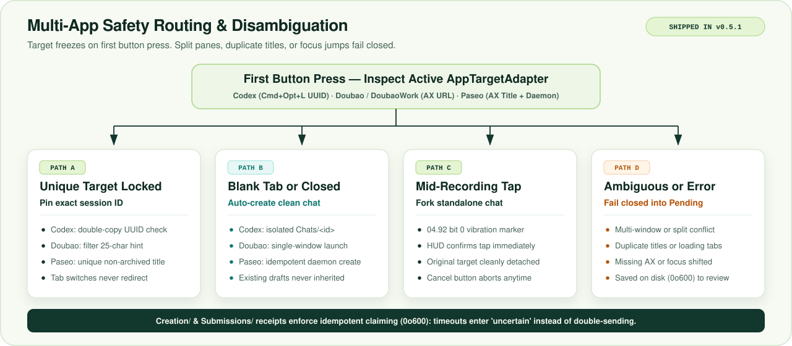

<a id="top"></a>

<p align="center">
  
</p>

<p align="center">
  <b>Turn your soundcore Work / Anker D3200 wearable AI recorder into a tactile macOS voice button &amp; inspiration workbench for Codex · Doubao · Paseo.</b>
</p>

<p align="center">
  
  
  
  
  
  
</p>

<p align="center">
  <a href="README.md">简体中文</a> · <b>English</b>
  &nbsp;&nbsp;|&nbsp;&nbsp;
  <a href="#live-workflow-at-a-glance">Live Demo</a> ·
  <a href="#three-tactile-hardware-guarantees">Tactile Gestures</a> ·
  <a href="#architecture--workbench-bento">Capabilities</a> ·
  <a href="#native-surfaces--supported-clients">Surfaces &amp; Clients</a> ·
  <a href="#quick-start">Quick Start</a> ·
  <a href="#pipeline-deep-dive--verification-status">Pipeline &amp; Verification</a> ·
  <a href="#troubleshooting-faq">FAQ</a>
</p>

---

## Live Workflow at a Glance

No focusing input boxes, no touching the keyboard—**BeanBridge** maintains an always-on Bluetooth Low Energy (BLE) link to your Anker D3200 on macOS, decrypts and resamples Opus streams purely in RAM, runs local `whisper.cpp` speech-to-text, and routes verified transcripts cleanly into the exact AI conversation locked on your first button press:

<p align="center">
   Live in-memory ASR -> Press to route safely" width="100%" />
</p>

<p align="center">
  <sub>▲ Auto-looping walkthrough: <b>① First press freezes your foreground thread</b> → <b>② 16kHz in-memory live preview (tab switches ignored)</b> → <b>③ Second press delivers with 0o600 receipt</b></sub>
</p>

---

## Three Tactile Hardware Guarantees

<p align="center">
  <picture>
    <source media="(prefers-color-scheme: dark)" srcset="docs/assets/tactile-gestures-en-dark.svg" />
    <source media="(prefers-color-scheme: light)" srcset="docs/assets/tactile-gestures-en-light.svg" />
    
  </picture>
</p>

> [!IMPORTANT]
> **Immutable First-Press Lock Rule**: Your destination is frozen on the **first physical button press** and displayed immediately in the HUD. Switching windows or tabs mid-sentence never redirects speech; if split panes, duplicate workspace tab titles, focus loss, or missing permissions create ambiguity, BeanBridge preserves your transcript in the `0o600` disk-backed `Pending/` inbox rather than **ever guessing a recent thread**.

---

## Architecture & Workbench Bento

<p align="center">
  <picture>
    <source media="(prefers-color-scheme: dark)" srcset="docs/assets/bento-overview-en-dark.svg" />
    <source media="(prefers-color-scheme: light)" srcset="docs/assets/bento-overview-en-light.svg" />
    
  </picture>
</p>

- **Pluggable Multi-App Routing (Codex / Doubao / Paseo)**: Powered by `AppTargetAdapter` and `AppTargetRegistry`. Switch your default target anytime from the Menu Bar, Floating HUD, or Workbench while sharing first-press locking, blank-tab session creation, and idempotent delivery receipts.
- **Zero-`ffmpeg` In-Memory Preview & Custom Hotwords**: Resamples `48kHz Opus -> 16kHz PCM` directly in Swift RAM with a sliding energy gate; injects custom domain vocabulary from `hotwords.txt` (pre-seeded with `BeanBridge`, `Codex`, `Doubao`, `Paseo`, `Whisper`, `Swift`, etc.) editable live in-app.
- **In-App ASR Model Manager & Dual Mirrors**: Supports 4 verified GGML tiers (`base` / `small-q5_1` / `small` / `medium`) with built-in **Hugging Face Official** and **`hf-mirror.com`** source switching, live speed/ETA, background resume when closed, and streaming SHA-256 verification.
- **Always-On Menu Bar Daemon & Offline VAD Workbench**: Pure native AppKit (`NSStatusItem` stays connected even with the HUD closed), `1s`–`30s` exponential backoff, and `NSWorkspace` sleep/wake protection. Away-from-desk recordings sync incrementally via `WorkbenchPanel` with energy-based VAD timestamp slicing, multi-keyword search, audio replay, and 1-click forwarding.

<p align="right"><a href="#top">↑ Back to Top</a></p>

---

## Native Surfaces & Supported Clients

### 1. Native macOS AppKit Surfaces

<p align="center">
  <picture>
    <source media="(prefers-color-scheme: dark)" srcset="docs/assets/ui-tour-dark.svg" />
    <source media="(prefers-color-scheme: light)" srcset="docs/assets/ui-tour-light.svg" />
    
  </picture>
</p>

<details>
<summary><b>Click to Expand: Surface Breakdown &amp; Global Keyboard Shortcuts</b></summary>

| Surface / Shortcut | Key Responsibilities &amp; Controls |
|---|---|
| **Menu Bar Item (`NSStatusItem`)** | Live BLE connection, battery %, active Whisper tier, recording state, reconnect countdown, and background model download progress |
| <kbd>⌘</kbd>+<kbd>V</kbd> **Floating HUD (`安克豆语音`)** | Switch default target app, monitor live in-memory ASR preview, inspect locked thread badge, or trigger **Probe (`检测目标`)**, **AX Auth**, and **Cancel (`取消本条`)** |
| <kbd>⌘</kbd>+<kbd>B</kbd> **Workbench (`WorkbenchPanel`)** | Incremental offline sync (`增量同步离机录音`), filter by All / Inspiration Inbox / Work Replay, multi-keyword search, audition VAD slices, edit text, and 1-click forward |
| <kbd>⌘</kbd>+<kbd>P</kbd> **Pending Inbox (`待发箱`)** | Review transcripts safely held by focus/ambiguity guards; paste an explicit deep link to deliver or spawn a clean standalone session |
| **ASR Model Manager (`ASRModelManagerWindow`)** | Open from Menu Bar or Workbench; switch between **HF Official** and **`hf-mirror.com`**, track speed/ETA, batch-verify SHA-256, or open `Models/` |
| **Extra Shortcuts** | <kbd>⌘</kbd>+<kbd>R</kbd> Reconnect D3200 Immediately · <kbd>⌘</kbd>+<kbd>Q</kbd> Quit Daemon |

</details>

### 2. Supported AI Desktop Clients

| Client (`appID`) | Bundle ID(s) | Foreground Lock Mechanism | Session Creation &amp; Delivery | Current Verification Status |
|---|---|---|---|---|
| **Codex** (`codex`) | `com.openai.codex` | `⌘⌥L` deep-link copy with dual-sample consistency + read-only `thread/read` | Creates isolated projectless `Chats/<id>` session; queues via `codex queue --thread` | **Physical D3200 E2E verified** (lock, cold start, tap-to-fork delivered &amp; replied) |
| **Doubao / DoubaoWork** (`doubao`) | `com.work.pc.doubao` / `com.bot.pc.doubao` / `com.bytedance.doubao` | Reads AX window URL (`chrome://doubaowork-chat/chat` mapped), filters built-in 25-char empty hint while guarding real drafts | `scripts/doubao-chat.py` exclusive receipts + single-window launch &amp; AX submit | **Verified on live `DoubaoWork.app`** (probe, single-window launch &amp; empty-box send passed) |
| **Paseo** (`paseo`) | `sh.paseo.desktop` | Reads `/agent/<id>` directly; on `/workspace/<id>` enables `AXEnhancedUserInterface` and pairs `kAXTitleAttribute` with daemon disambiguation | `scripts/paseo-chat.py` + `paseo-daemon-helper.mjs` idempotent create + `paseo send --behavior steer` | **Physical D3200 E2E verified on maximized workspace** (locks &amp; delivers live; draft create &amp; tap pending live test) |

<details>
<summary><b>Click to Expand: Per-Client Setup Notes &amp; Optional Environment Overrides</b></summary>

#### Using Codex Desktop
- Ensure desktop Codex is signed in (auto-discovers bundled `CodexCLI.app` or `codex` on `PATH`; override via `BEANBRIDGE_CODEX`).
- Keep default `⌘⌥L` *Copy Chat Deep Link* enabled (if customized, override virtual keycode via `BEANBRIDGE_COPY_KEYCODE`, default `37` = `L`).
- Leave a single Codex window in the foreground when pressing D3200; blank pages or a closed app automatically spawn a clean standalone session after recording stops.

#### Using Doubao / DoubaoWork
- Supports consumer Doubao and enterprise `DoubaoWork.app` (override bundle ID priority via comma-separated `BEANBRIDGE_DOUBAO_BUNDLE_ID`).
- `CurrentChat.isDoubaoPlaceholderOrEmpty` automatically ignores DoubaoWork's built-in 25-character empty input prompt hint while protecting genuine user-typed drafts from accidental overwrite.
- Optional overrides: `BEANBRIDGE_DOUBAO_BRIDGE_CMD` (custom submission script) or `BEANBRIDGE_DOUBAO_AX_SUBMIT=0` (disable built-in AX submit).

#### Using Paseo
- Supports standalone agent URLs (`paseo://h/<serverId>/agent/<id>` / `https://app.paseo.sh/h/<serverId>/agent/<id>`) as well as maximized/fullscreen workspace views (`/h/<serverId>/workspace/<workspaceId>`).
- Automatically ignores fullscreen auxiliary strips and queries `resolve-workspace-tab` against the local Paseo daemon to pinpoint the unique non-archived session.
- **Fail-Closed Disambiguation**: Blank draft tabs (`"新建 Agent"` / `"New Agent"` / `"New tab"`) trigger clean session creation upon completion; duplicate titles or multi-agent split views fail closed into `Pending`.
- Optional overrides: `BEANBRIDGE_PASEO_PROVIDER`, `BEANBRIDGE_PASEO_WORKSPACE_ID`, `BEANBRIDGE_PASEO_CWD`, `BEANBRIDGE_PASEO_CLI`.

</details>

<p align="right"><a href="#top">↑ Back to Top</a></p>

---

## Quick Start

### Step 1: Clone & Install Whisper Runtime

```bash
git clone https://github.com/sup-lh/beanbridge.git
cd beanbridge
brew install whisper.cpp
```

> Primarily tested on Apple Silicon, macOS 26.6.2, Xcode 26.2 / Swift 5.10, and `whisper.cpp` 1.9.5 (minimum deployment target macOS 14+). Live preview resampling runs entirely in RAM—`ffmpeg` is not required for standard button usage.

### Step 2: Build & Launch (Download Models In-App or via CLI)

```bash
./build-button-app.sh
open "dist/安克豆按键语音.app"
# Or double-click `启动按键语音.command` in the repository root
```

- **Recommended — In-App Model Download Center**: Open **「ASR 模型管理与下载…」** from the menu bar (or **「ASR 模型与下载」** inside Workbench), select **Hugging Face Official** or **`hf-mirror.com`**, and download **`Small` (~465 MB)** or **`Small-Q5_1` (~181 MB)**.
- **Alternative — CLI Pre-Install**:
  ```bash
  ./scripts/setup-model.sh --tier small-q5_1 --set-default
  ```

<details>
<summary><b>Expand Table: 4 Whisper GGML Tiers &amp; Resolution Order</b></summary>

| Tier (`--tier`) | Filename | Approx. Size | Best For |
|---|---|---|---|
| `base` | `ggml-base.bin` | ~141 MiB | Lowest latency baseline fallback |
| `small-q5_1` | `ggml-small-q5_1.bin` | ~181 MiB | Balanced speed &amp; quantized EN/ZH accuracy |
| `small` | `ggml-small.bin` | ~465 MiB | **Recommended daily driver** for Chinese &amp; bilingual dictation |
| `medium` | `ggml-medium.bin` | ~1.43 GiB | Flagship accuracy for dense terminology; higher CPU/disk usage |

Resolution order: `BEANBRIDGE_MODEL` env var ＞ `support/model-preference` ＞ highest installed local tier (`medium > small > small-q5_1 > base`) ＞ fallback `Models/ggml-base.bin`.

</details>

### Step 3: Grant Permissions & Speak

1. **Release Mobile BLE Link**: Temporarily turn off iPhone Bluetooth (so mobile Feishu/Lark isn't holding the D3200 connection) and keep the D3200 idle near your Mac.
2. **Grant Bluetooth & Accessibility**: Approve macOS **Bluetooth** access, then click **「辅助功能授权」** in the HUD and enable **安克豆按键语音** under *System Settings → Privacy & Security → Accessibility*.
3. **Probe & Dictate**: Pick your default target app, optionally click **「检测目标」** (switch back to your target window within 3 seconds for a read-only check), then **press D3200 once to speak → watch live HUD preview → press again to deliver**!

> [!TIP]
> **Permission denied right after rebuilding?**
> `./build-button-app.sh` uses ad-hoc signing (`codesign --sign -`), which invalidates prior macOS TCC entries. Run once and re-toggle Accessibility:
> ```bash
> tccutil reset Accessibility dev.codex.anker-button-voice
> ```

<p align="right"><a href="#top">↑ Back to Top</a></p>

---

## Pipeline Deep Dive & Verification Status

### End-to-End Voice-to-Agent Pipeline

<p align="center">
  <picture>
    <source media="(prefers-color-scheme: dark)" srcset="docs/assets/flow-dark.svg" />
    <source media="(prefers-color-scheme: light)" srcset="docs/assets/flow-light.svg" />
    
  </picture>
</p>

<details>
<summary><b>Expand Diagram: Multi-App Safety Routing &amp; Disambiguation Decision Tree (Paths A–D)</b></summary>

<br />

<p align="center">
  <picture>
    <source media="(prefers-color-scheme: dark)" srcset="docs/assets/multi-app-routing-dark.svg" />
    <source media="(prefers-color-scheme: light)" srcset="docs/assets/multi-app-routing-light.svg" />
    
  </picture>
</p>

</details>

<details>
<summary><b>Expand Diagram: BLE Auto-Reconnect &amp; Sleep/Wake State Machine (ReconnectCoordinator)</b></summary>


</details>

### Verification Status & Known Boundaries

We strictly separate **live physical hardware end-to-end verification** from **automated test coverage**:

| Area | Verification Method | Status &amp; Boundaries |
|---|---|---|
| D3200 BLE discovery, live Opus decrypt &amp; BlackHole mic bridge | Physical D3200 hardware | **Verified live** |
| Codex foreground lock, tab-switch guard, cold start &amp; `04.92` tap-to-fork | Physical D3200 E2E | **Verified live** (confirmed delivered &amp; replied) |
| `DoubaoWork.app` probing, single-window launch &amp; 25-char empty hint filter | Live local `DoubaoWork.app` | **Verified on desktop client** |
| Paseo maximized workspace current-session lock &amp; D3200 button delivery | Physical D3200 + live `Paseo.app` E2E | **Verified live** (multiple messages delivered to active session; draft auto-create &amp; mid-recording tap pending live test) |
| In-app ASR Model Manager (`ggml-small.bin` 465 MB download &amp; SHA-256 verify) | Live `.app` UI + unit tests | **Verified live &amp; automated** |
| BLE reconnect backoff, sleep/wake recovery, incremental offline sync &amp; VAD archive | Swift / Python suites + Release build | **49 Swift XCTests + 16 Python unittests + `verify-release.sh` PASS**; **full-day sleep endurance &amp; large offline hardware backlog remain untested on hardware** |

> [!NOTE]
> A `queued` receipt confirms handoff to the target CLI or daemon; actual appearance inside the client chat window remains the source of truth. Raw audio and private conversations are never committed to Git.

<details>
<summary><b>Expand Reference: Dry-Run, Fixed Binding, BlackHole Mic Bridge, Disk Layout &amp; Env Vars</b></summary>

#### Transcribe Only Without Delivering (`dry-run`)
```bash
touch "$HOME/Library/Application Support/AnkerVoiceBridge/dry-run"
open "dist/安克豆按键语音.app"
# Delete dry-run after quitting the app to restore live delivery
```

#### Legacy Fixed Codex Thread Binding (`fixed` mode)
```bash
python3 scripts/set-target.py --thread-id "<TARGET_UUID>"
printf 'fixed\n' > "$HOME/Library/Application Support/AnkerVoiceBridge/routing-mode"
# Delete routing-mode or write "current" to return to foreground locking; add --check for read-only validation
```

#### BlackHole Virtual Microphone Bridge
```bash
brew install blackhole-2ch
swift build -c release --product anker-voice-bridge
.build/release/anker-voice-bridge
# Do not run simultaneously with 安克豆按键语音.app; Ctrl-C restores your prior default input (1h max)
```

#### Local Persistence Directory (`0o700` dirs / `0o600` sensitive files)
`~/Library/Application Support/AnkerVoiceBridge/`:
- `target-app`, `model-preference`, `hotwords.txt`
- `Models/`, `Pending/`, `Creation/`, `Submissions/`
- `Workbench/` (`sync-manifest.json`, full-text segment index & sliced VAD audio)
- `Chats/` (projectless Codex sessions), `PaseoVoice/` (default Paseo session CWD)

#### Environment Overrides (when launched from the same shell)
- **Routing**: `BEANBRIDGE_TARGET_APP` (`codex` / `doubao` / `paseo`), `BEANBRIDGE_ROUTING` (`current` / `fixed`), `BEANBRIDGE_COPY_KEYCODE` (default `37`), `BEANBRIDGE_SCRIPTS_DIR`
- **Codex**: `BEANBRIDGE_CODEX`, `BEANBRIDGE_CODEX_BUNDLE_ID`
- **Doubao**: `BEANBRIDGE_DOUBAO_BUNDLE_ID`, `BEANBRIDGE_DOUBAO_BRIDGE_CMD`, `BEANBRIDGE_DOUBAO_AX_SUBMIT` (`0` disables AX submit), `BEANBRIDGE_DOUBAO_DIAG=1`
- **Paseo**: `BEANBRIDGE_PASEO_BUNDLE_ID`, `BEANBRIDGE_PASEO_CLI`, `BEANBRIDGE_PASEO_APP`, `BEANBRIDGE_PASEO_HOST`, `BEANBRIDGE_PASEO_HOME`, `BEANBRIDGE_PASEO_PROVIDER`, `BEANBRIDGE_PASEO_CWD`, `BEANBRIDGE_PASEO_WORKSPACE_ID`, `BEANBRIDGE_PASEO_DIAG=1`
- **ASR &amp; Tooling**: `BEANBRIDGE_MODEL`, `BEANBRIDGE_MODEL_BASE_URL`, `BEANBRIDGE_WHISPER`, `BEANBRIDGE_WHISPER_NO_GPU=1`, `BEANBRIDGE_FFMPEG`, `BEANBRIDGE_PYTHON`

</details>

---

## Troubleshooting FAQ

<details>
<summary><b>Q1: Accessibility is enabled in System Settings—why does Target Probe still report permission denied?</b></summary>

Rebuilding via `./build-button-app.sh` ad-hoc re-signs the app bundle, invalidating prior macOS TCC entries. Run:
```bash
tccutil reset Accessibility dev.codex.anker-button-voice
```
Then relaunch `dist/安克豆按键语音.app` and re-enable it under *System Settings → Privacy & Security → Accessibility*.

</details>

<details>
<summary><b>Q2: Maximized Paseo reports "No target", or how does BeanBridge handle duplicate tab titles?</b></summary>

- If the active Paseo tab is a blank draft (**"新建 Agent" / "New tab"**), read-only probing intentionally reports no target because no persistent session ID exists yet—pressing D3200 to speak will automatically create an isolated session in that workspace and deliver your message.
- If multiple non-archived sessions share the exact same title in one workspace or a split view displays multiple agents, BeanBridge fails closed into `Pending` rather than guessing. Rename one tab uniquely or inspect `~/Library/Application Support/AnkerVoiceBridge/paseo-ax-diag.json`.

</details>

<details>
<summary><b>Q3: Why does DoubaoWork no longer pop an extra browser shell or mistake an empty box for a draft?</b></summary>

Both were resolved in `v0.5.1`: cold starts launch `com.work.pc.doubao` cleanly without `doubaowork://` URLs that triggered `DoubaoWork Browser.app`, and `CurrentChat.isDoubaoPlaceholderOrEmpty` filters DoubaoWork's 25-character built-in prompt hint while still guarding real user-typed drafts.

</details>

<details>
<summary><b>Q4: How can I boost accuracy on mixed Chinese/English or technical identifiers like AppTargetAdapter?</b></summary>

1. Open **「ASR 模型管理与下载…」** from the menu bar and switch to **`Small` (~465 MB)** or **`Small-Q5_1` (~181 MB)**.
2. Click **「编辑专业术语热词表…」** to add repo names, symbols, and English terms into `hotwords.txt`.

</details>

<details>
<summary><b>Q5: Mobile Feishu/Lark grabs the D3200 connection, or BLE stays idle right after Mac wake?</b></summary>

Briefly toggle iPhone Bluetooth off so mobile releases the link; upon Mac wake, `ReconnectCoordinator` automatically transitions from `.sleeping` back to exponential-backoff scanning (`1s`–`30s`), or press <kbd>⌘</kbd>+<kbd>R</kbd> in the menu bar to reconnect immediately.

</details>

---

## Development, Tests & Repository Layout

```bash
swift build -c release
swift test
/usr/bin/python3 -m unittest scripts/test-create-chat.py scripts/test-doubao-chat.py scripts/test-paseo-chat.py
./scripts/verify-release.sh
```

```text
Sources/AnkerButtonVoice/    Menu bar daemon, floating HUD, ASRService/hotwords, Model Manager UI, Workbench UI
Sources/AnkerVoiceBridge/    BlackHole virtual mic audio bridge & system input save/restore
Sources/AnkerEventProbe/     Read-only BLE control packet & 04.92 tap flag diagnostic CLI
Sources/OpenBeanKit/         OpenBean-derived BLE/Opus core, ASRModelCatalog, ReconnectCoordinator, WorkbenchSync
Sources/VoiceRouting/        AppTargetAdapter protocol, Codex/Doubao/Paseo adapters, AX inspection, PendingStore
scripts/                    Model setup, client bridges & daemon helper, visual asset generator, 16 Python tests
Tests/                      OpenBeanKitTests & VoiceRoutingTests (49 Swift XCTests)
docs/                       Field notes, routing design, brand asset catalog & product roadmap
```

## Attribution & License

- Core BLE device protocol & portions of `OpenBeanKit` are adapted from [OpenBean](https://github.com/imraywang/openbean) (baseline commit `13968d8ea27ca57fa254bf01c43c13c388f1a696`); see [docs/third-party.md](docs/third-party.md) and [NOTICE-OpenBean](NOTICE-OpenBean).
- Code, documentation, and original visual assets in this repository are licensed under [Apache-2.0](LICENSE); external dependencies (`whisper.cpp`, BlackHole, GGML models) follow their respective licenses. Not officially affiliated with Anker, Feishu/Lark, OpenAI, ByteDance/Doubao, or Paseo.

<p align="right"><a href="#top">↑ Back to Top</a></p>
