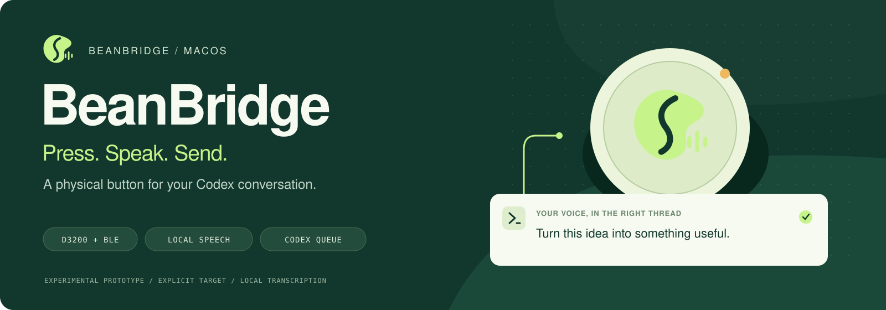
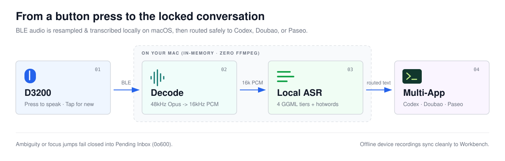

<p align="center">
  
</p>

<h1 align="center">豆桥 · BeanBridge</h1>

<p align="center">给 Codex、豆包等桌面 AI 客户端接上一颗随身语音按钮与工作台。</p>
<p align="center"><b>按一下说话 · 看浮窗预览 · 再按一下投递</b></p>
<p align="center">
  <a href="#快速开始">快速开始</a> ·
  <a href="docs/field-notes.md">完整实验记录</a> ·
  <a href="docs/context-routing.md">自动选对话方案</a> ·
  <a href="docs/product-ideas.md">产品设想</a> ·
  <a href="docs/brand.md">视觉物料</a>
</p>

---

BeanBridge 将 soundcore Work / 安克 AI 录音豆 D3200 通过蓝牙连接到 Mac，在本机完成高精度语音识别，并把最终文字路由投递到指定目标应用（目前已支持 **Codex**、**豆包 Doubao** 与 **Paseo** 适配器，可通过 `AppTargetAdapter` 扩展更多桌面应用）。同时提供菜单栏常驻、BLE 断线自动重连与睡眠唤醒恢复、离机录音增量同步、VAD 分段与灵感收集箱工作台面板。

**实测边界说明**：Codex 前台锁定、关闭后冷启动建聊、录音中轻敲（`04.92` `userMarked`）改发新会话及 BlackHole 音频桥均已在真机 D3200 实体按键上端到端验证通过；**豆包工作版 `DoubaoWork.app`**（目标探测、单窗口唤醒与空框占位符发送）、**应用内 ASR 模型管理与下载中心**（已在本机实测下载并校验 `ggml-small.bin` 465 MB），以及 **Paseo 最大化工作区窗口目标锁定与真机实体按键端到端送达当前会话**均已完成真实桌面端验收；Paseo 草稿/空白页自动新建会话、BLE 自动重连/休眠恢复、离机增量同步与灵感收集箱工作台面板已通过全量 Swift/Python 单元测试（49 项 Swift + 16 项 Python）、`release` 构建与本地自检脚本验证，**尚未完成 Paseo 草稿页建聊/轻敲新会话及 D3200 全天睡眠/离线积压实机测试**。

## 两种使用方式

| | 按键语音工作台 · 推荐 | 虚拟麦克风桥 |
|---|---|---|
| 开始 | 按一次录音豆 | 启动脚本，由程序开始录音 |
| 说话 | 浮窗无 `ffmpeg` 内存降采样实时预览（支持“取消本条”） | 在应用内点麦克风输入 |
| 结束 | 再按一次，本地高精度转写并自动排队投递（或轻敲改发新会话） | 终端按 Control-C |
| 识别 | `whisper.cpp` 本地完成（支持 `base`/`small-q5_1`/`small`/`medium` 与 `hotwords.txt` 热词） | 由使用麦克风的应用处理 |
| 发送目标 | 首次按键时读取并锁定的前台目标对话（Codex / 豆包等可切换） | 当前由你操作的输入框 |
| 额外依赖 | `whisper.cpp` 与本地模型（默认 `ggml-base.bin` 约 141 MiB） | BlackHole 2ch |



音频在本机转写，**最终文字会进入所选目标应用**（Codex / 豆包等），并按你使用的账号与模型配置处理。录音豆仍会保存自己的录音，除通过工作台面板增量同步到本地归档外，恢复手机连接后也可能同步到飞书。

## 验证状态

- [x] **真机实体按键实测**：D3200 蓝牙发现、握手、实时音频解码与 BlackHole 麦克风桥。
- [x] **真机实体按键实测**：实体按键开始/结束、浮窗预览、Codex 前台会话锁定/切页防串、冷启动建聊、录音中轻敲（`04.92` `flags=01` bit 0）改发新会话并真实收到回复；Paseo 最大化工作区窗口当前会话识别、按键录音投递并真实送达当前对话。
- [x] **桌面端与 UI 实测**：`DoubaoWork.app` 目标探测、单窗口冷启动/轻敲唤醒及空框占位符投递已本机验证；应用内「ASR 语音识别模型管理与下载中心」已完成 `ggml-small.bin` 实机下载、进度追踪与 SHA-256 校验切换。
- [x] **单元测试与本地脚本验证**：`AppTargetAdapter` 多目标抽象、豆包适配器与 Paseo 适配器（`PaseoTargetAdapter` / `scripts/paseo-chat.py` + `scripts/paseo-daemon-helper.mjs`）、`TargetAppPreferenceStore`、`ASRModelCatalog` 多源下载/校验状态机与热词、无 `ffmpeg` 内存重采样 `LivePreview`、`NSStatusItem` 菜单栏与 `WorkbenchPanel` 工作台、以及 `ReconnectCoordinator` / `WorkbenchSync` 均通过编译与自动测试（49 项 Swift + 16 项 Python；Paseo 空白/草稿页自动建聊、轻敲新会话及全天睡眠稳定性待实测）。

> **每段录音的目标在首次按键时锁定。** 浮窗显示目标标题，录音中切换对话不会改目标。读取失败时文字保存在本地待发箱，绝不使用旧的固定目标。第二次按键会自动提交最终识别文字，预览和最终结果可能有差异。

## 快速开始

### 1. 准备环境

实测环境：Apple 芯片、macOS 26.6.2、Xcode 26.2、Codex CLI 0.167.0、whisper.cpp 1.9.5。Swift 包声明最低 macOS 14，但更早系统和 Intel Mac 尚未实测。

需要 Xcode / Swift 开发工具、Python 3、已登录的 Codex，以及以下程序：

```bash
gh repo clone sup-lh/beanbridge
cd beanbridge
brew install whisper.cpp   # 可选同时安装 ffmpeg（当前仅用于特定离线容器导出回退，实时预览已无需 ffmpeg）
./scripts/setup-model.sh --tier small-q5_1 --set-default   # 不加参数默认下载 ggml-base.bin
```

模型安装脚本（以及应用内置下载中心）会逐块核对 SHA-256（支持 `base` / `small-q5_1` / `small` / `medium`，或环境变量 `MODEL_TIER`）；若已有正确模型会直接复用。也可在菜单栏「ASR 模型管理与下载…」或工作台右上角「ASR 模型与下载」中直接选择 **Hugging Face 官方源** 或 **HF 镜像源 (hf-mirror.com)** 下载并查看实时进度条、速度与剩余时间（关闭窗口会在后台继续，完成后自动校验切换），偏好写入 `~/Library/Application Support/AnkerVoiceBridge/model-preference`；同一窗口或工作台也可编辑热词表 `~/Library/Application Support/AnkerVoiceBridge/hotwords.txt`（默认预置“安克豆”“BeanBridge”“Codex”“豆包”“Doubao”“飞书”等术语）。它不会安装 BlackHole，按键模式也不需要 BlackHole。

### 2. 选择路由方式与目标应用

默认使用 `current` 模式，默认目标为 `codex`（可在菜单栏、浮窗或工作台选择器切换为 `doubao` 豆包或 `paseo` Paseo，偏好存于 `~/Library/Application Support/AnkerVoiceBridge/target-app`，环境变量 `BEANBRIDGE_TARGET_APP` 可覆盖；豆包可选用 `BEANBRIDGE_DOUBAO_BUNDLE_ID`、Paseo 可选用 `BEANBRIDGE_PASEO_BUNDLE_ID` / `BEANBRIDGE_PASEO_PROVIDER` 覆盖），无需预先绑定。打开目标应用（Codex、豆包或 Paseo）的对话窗口，并保持它在前台。Codex / 豆包网页路由在第一次按键时通过 **⌘⌥L** 或窗口 URL 状态采集目标，Paseo 通过 Auxiliary Accessibility 读取 `AXWebArea` URL 与当前激活的工作区标签（`workspace-tab-agent_*`），核对一致后锁定目标。

首次使用，在浮窗点击「辅助功能授权」，然后在「系统设置 → 隐私与安全性 → 辅助功能」中允许「安克豆按键语音」。点击「检测目标」后有 3 秒切回目标应用，检测仅显示目标，不发送消息。

目标应用不在前台、存在多个窗口或分屏歧义、未取得新链接或缺少权限时，继续接收录音，最终文字进入「待发箱」。可以在待发箱粘贴明确的聊天链接后发送（支持 `codex://threads/<id>`、`doubao://chat/<id>`、`doubaowork://chat/<id>`、`https://www.doubao.com/chat/<id>`、`paseo://h/<serverId>/agent/<id>`、`paseo://agent/<id>`、`https://app.paseo.sh/h/<serverId>/agent/<id>` 等）；不会读取旧剪贴板猜目标。

若要继续使用原来的固定目标模式：

```bash
python3 scripts/set-target.py --thread-id "替换为目标会话的 UUID"
printf 'fixed\n' > "$HOME/Library/Application Support/AnkerVoiceBridge/routing-mode"
```

删除 `routing-mode` 文件或将内容改为 `current` 即恢复自动模式。固定目标保存在同目录的 `target-thread`；`set-target.py --check` 仅验证，`--json` 返回校验结果，均不改配置。

### 3. 构建并连接

```bash
./build-button-app.sh
open "dist/安克豆按键语音.app"
```

在 iPhone「设置 → 蓝牙」暂时关闭蓝牙，或以其他方式确保手机飞书没有占用录音豆连接。将录音豆放到 Mac 附近，确认它当前没有在录音。保留原有设备绑定即可。

首次运行需要蓝牙权限。如果没有自动弹窗，可在「系统设置 → 隐私与安全性 → 蓝牙」添加 `安克豆按键语音.app`，授权后退出并重新打开。

### 4. 按一下，说话，再按一下

| 步骤 | 你做什么 | 浮窗表现 |
|---|---|---|
| 就绪 | 等待连接成功 | 准备就绪，按一下录音豆 |
| 开始 | 将 Codex 对话置前，短按一次，等目标标题出现再切换页面 | 正在录音，显示锁定目标和识别预览 |
| 结束 | 再短按一次 | 正在生成最终文字 |
| 提交 | 无需再点发送 | 已放入 Codex 队列 |

Codex 忙时消息可能等待当前回合结束。**“已放入队列”表示入队成功，不保证模型立即开始处理。** 最终应以目标对话实际出现消息为准。

需要把本条发给新会话时，在录音中轻敲机身直到设备震动，确认浮窗显示“轻敲已确认”，再按键结束。重复轻敲不会重复建聊；空白页或关闭目标应用时仍只创建一条会话。轻敲不继承当前会话历史，每段录音重新决定目标。录音进行中若不想继续发送，可点击浮窗或菜单栏的「取消本条」，立即停用预览并丢弃本段内容（后续设备停止事件将静默忽略）。

应用以菜单栏图标（`NSStatusItem`）常驻后台，关闭浮窗仅会隐藏窗口而不断开 BLE 监听；若需彻底关闭可从菜单栏退出。结束硬件测试前建议先用实体键停止录音，再退出应用或恢复手机蓝牙。

可在菜单栏或浮窗打开「工作台（灵感收集箱与分段回放）」，执行离机录音增量同步、关键词/分类分段检索、分段试听播放、复制文本、一键转发给当前目标或新建独立会话，以及管理热词与 ASR 模型偏好。

<details>
<summary><b>只测试识别，不自动发送</b></summary>

关闭应用后运行：

```bash
touch "$HOME/Library/Application Support/AnkerVoiceBridge/dry-run"
open "dist/安克豆按键语音.app"
```

恢复自动发送：关闭应用，删除上述 `dry-run` 标记，再打开应用。

</details>

<details>
<summary><b>使用 BlackHole 虚拟麦克风</b></summary>

这条路径适合继续使用 Codex 自带的麦克风输入。先安装 [BlackHole 2ch](https://github.com/ExistentialAudio/BlackHole)，按安装器要求重启。仓库不附带其安装包。

```bash
brew install blackhole-2ch
swift build -c release --product anker-voice-bridge
.build/release/anker-voice-bridge
```

等待“实时音频已接通”，然后在 Codex 点击麦克风。程序自动开始录音，这时不要再按录音豆按钮。终端按 Control-C 结束；正常退出会恢复启动前的系统输入。如果运行期间你手动换了输入，它会保留你的选择。

异常退出时请检查录音灯及系统输入。程序最长运行一小时；它不是全天录音服务。请勿与按键应用同时运行。

</details>

## 自动路由与待发箱

| 场景 | 当前行为 |
|---|---|
| 目标应用（Codex / 豆包）在前台、只有一个窗口且显示已有对话 | 首次按键读取并校验该对话，锁定到本段录音结束 |
| 刚打开的新建空白页，没有聊天链接 | 录音结束后自动新建独立会话并发送，不弹确认框 |
| 录音中轻敲机身直到震动 | 本段改为新建独立会话并发送；浮窗显示轻敲已确认 |
| 录音中切换到其他对话 | 仍然投递到浮窗显示的锁定目标 |
| 无权限、目标应用在后台、多窗口或未取得链接 | 保存文字；在待发箱粘贴明确链接后发送（带对应应用标签） |
| 提交超时、程序中断或结果不明 | 保留记录供核对，不自动重试 |
| 目标应用未运行或已关闭所有窗口 | 识别完成后创建独立会话，启动/打开目标应用并投递 |

空白页尚未建立可复制的对话 ID。按用户设置：前台与窗口检查通过，但复制链接超时后，会在录音结束时自动新建独立会话。快捷键失效也会走这个新建路径，不会误投旧会话；新会话不继承空白页里选的项目、模型或草稿。权限不足、焦点变化等其他错误仍进入待发箱。待发箱里尚无目标的文字也可直接选择“新建独立会话并发送”。

待发记录位于 `~/Library/Application Support/AnkerVoiceBridge/Pending`，文件权限为 600、目录为 700，不上传仓库。包含最终文字、目标和投递状态；入队后的记录也保留在本机，可自行清理。`queued` 只说明 CLI 返回成功，最终以目标聊天实际出现消息为准。

新会话不绑定项目，每条使用 `~/Library/Application Support/AnkerVoiceBridge/Chats/<消息 ID>` 作为独立工作目录。空录音不建聊，首次按键时决定创建计划；录音中手动打开其他聊天也不会改发到该聊天。Codex 仅在后台或最小化时不视为关闭。已退出应用不需要辅助功能来判定；判断“所有窗口已关闭”仍需要辅助功能权限。`fixed` 模式继续遵守固定目标。

创建回执保存在同目录下的 `Creation` 文件夹。先取得真实 ID 并持久化，再打开桌面和排队投递；超时或结果不明时不会自动再建一个会话。创建助手在取得持久会话后退出，模型执行交给桌面，不在独立助手中启动模型回合。

实测与剩余边界见 [自动选对话实现说明](docs/context-routing.md)。

## 限制与排错

- **识别准确度与模型开销**：默认回退 `ggml-base.bin` 较轻量但专有名词易误听；建议使用 `./scripts/setup-model.sh --tier small-q5_1 --set-default`（或 `small` / `medium`）并在 `hotwords.txt` 补充专业词汇。实时预览已取消每轮拉起 `ffmpeg` 进程并在内存中完成 48k→16k 重采样与静音能量门控，但大模型全天续航与长时间发热仍需更多实机压测。
- **长度**：按键模式在结束后检查音频，超过 5 分钟不自动发送；这不是录满 5 分钟就自动停录。
- **重连与睡眠恢复**：已实现 `ReconnectCoordinator` 指数退避后台重连与 `NSWorkspace` 系统休眠/唤醒状态恢复逻辑（`.sleeping` 状态不触发无效重连），并通过状态机单元测试，但真实 D3200 全天休眠续航场景尚未实机长测。
- **豆包、Paseo 与工作台**：`DoubaoTargetAdapter` 已在本机完成 `DoubaoWork.app` 真实窗口探测、单窗口唤起与发送验证；`PaseoTargetAdapter` 已在本机完成最大化工作区当前会话识别与实体按键发送至当前对话的端到端验收；`OfflineSyncCoordinator`、`AudioVADslicer` 与 `WorkbenchArchive` 已通过 Swift/Python 单元测试；Paseo 草稿/空白页自动建聊、轻敲改发新会话及工作台海量离线录音积压尚待实机验收。
- **声音数据**：仓库没有原始录音；程序正常处理完成会清理本机临时音频，崩溃时仍可能残留临时文件。设备录音不会自动删除，离机增量同步依赖 `Workbench/sync-manifest.json` 断点追踪去重。
- **权限与签名**：应用是本机临时签名，重建会改变签名，可能需要重新授权蓝牙及辅助功能；没有 Apple 公证发布包。若辅助功能列表显示开启但检测仍无权限，可运行 `tccutil reset Accessibility dev.codex.anker-button-voice` 仅重置本应用，再用“+”添加当前 `dist/安克豆按键语音.app` 并开启。
- **发送失败**：先持久化文字再提交；超时或中断的消息不会自动重发，需在目标聊天核对。不承诺跨外部客户端的严格一次投递保证。

更多故障现象和原因见 [踩坑记录](docs/field-notes.md)。

## 开发与验证

```bash
swift build -c release
swift test
/usr/bin/python3 -m unittest scripts/test-create-chat.py scripts/test-doubao-chat.py scripts/test-paseo-chat.py
./scripts/verify-release.sh
```

程序会查找常见安装目录及 `PATH`。特殊位置或行为覆盖可使用 `BEANBRIDGE_FFMPEG`、`BEANBRIDGE_WHISPER`、`BEANBRIDGE_CODEX`、`BEANBRIDGE_MODEL`、`BEANBRIDGE_TARGET_APP`（如 `codex`、`doubao` 或 `paseo`）、`BEANBRIDGE_DOUBAO_BUNDLE_ID`、`BEANBRIDGE_PASEO_BUNDLE_ID`、`BEANBRIDGE_PASEO_CLI`、`BEANBRIDGE_PASEO_PROVIDER`、`BEANBRIDGE_PASEO_CWD`、`BEANBRIDGE_PASEO_WORKSPACE_ID`；通过环境变量配置时应从同一终端直接运行可执行文件，Finder 启动的应用不保证继承终端环境。路由可用 `BEANBRIDGE_ROUTING=current|fixed` 覆盖；若仅改了复制快捷键的字母，可用 `BEANBRIDGE_COPY_KEYCODE` 指定 macOS 虚拟键码（默认 37，即 L，修饰键仍为 Command + Option）。

```text
Sources/AnkerButtonVoice/    按键事件、ASR 服务与热词、下载中心弹窗、无 ffmpeg 预览、菜单栏/浮窗与工作台面板
Sources/AnkerVoiceBridge/    音频桥、系统输入切换与恢复
Sources/OpenBeanKit/         改编自 OpenBean 的协议、ASR 模型目录与下载器、BLE 自动重连与离机增量同步/VAD归档
Sources/VoiceRouting/        可插拔多目标适配器协议、Codex/豆包/Paseo 桥接、链接校验、持久化待发箱
scripts/                    模型多层级安装、对话绑定与豆包/Paseo 桥接、发布校验、视觉物料生成
Tests/                      OpenBeanKitTests 与 VoiceRoutingTests 单元测试（49 项）
docs/                       实验记录、产品设想、路由方案、品牌物料
```

## 来源与许可

设备协议及相关 Swift 实现来自 [OpenBean](https://github.com/imraywang/openbean)，基准提交 `13968d8ea27ca57fa254bf01c43c13c388f1a696`。本项目补充了 Codex 队列连接、独立浮窗、音频桥、状态检查、文档及视觉物料。变更范围见 [第三方来源](docs/third-party.md)。

仓库代码、文档及原创图形采用 [Apache-2.0](LICENSE)；上游声明保留在 [NOTICE-OpenBean](NOTICE-OpenBean)。外部安装的 BlackHole、whisper.cpp 和语音模型遵循各自许可。本项目与 Anker、飞书及 OpenAI 无官方关联。
