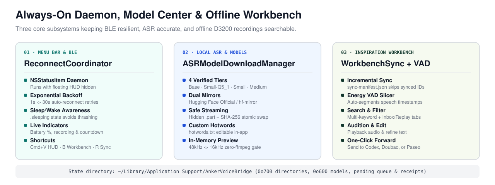
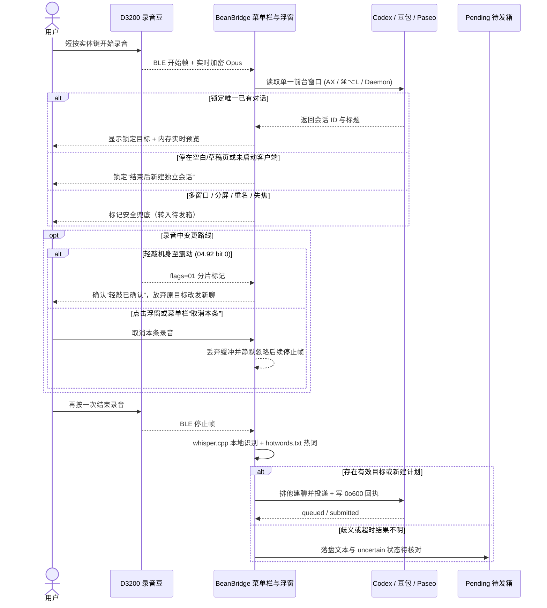
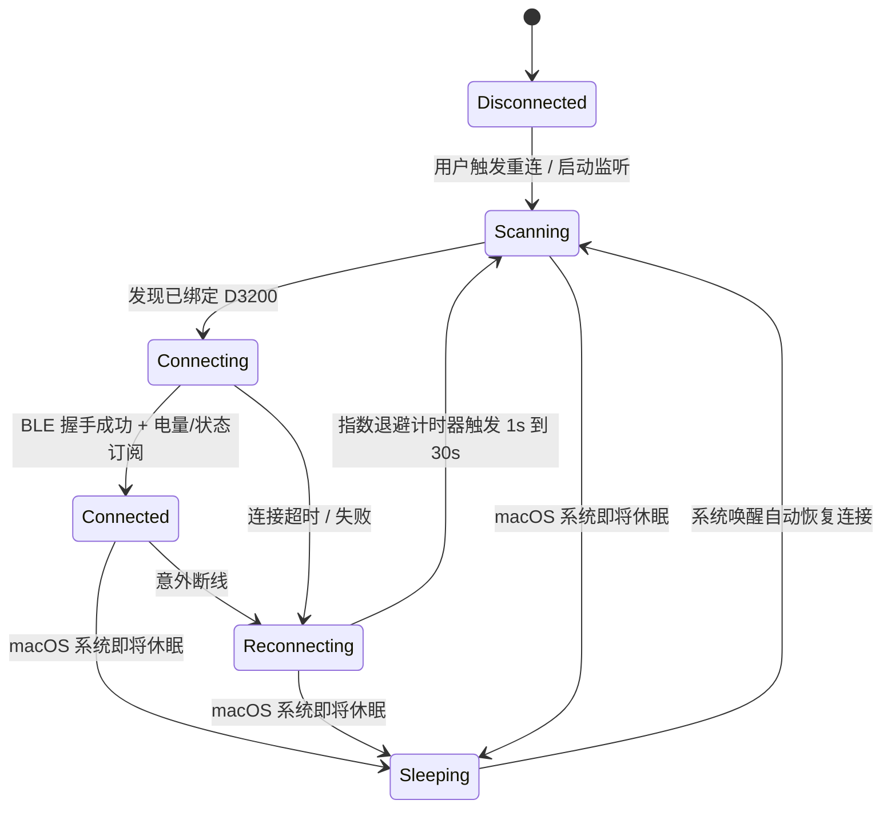

<a id="top"></a>

<p align="center">
  
</p>

<h1 align="center">豆桥 · BeanBridge</h1>

<p align="center">把 soundcore Work / 安克 AI 录音豆（D3200）接入 Mac，变成 <b>Codex · 豆包 · Paseo</b> 的随身语音输入按键与灵感工作台。</p>

<p align="center"><b>按一下说话 · 内存实时预览 · 轻敲改发新聊 · 再按安全投递</b></p>

<p align="center">
  <b>简体中文</b> · <a href="README.en.md">English</a>
</p>

<p align="center">
  <code>macOS 14+</code> ·
  <code>Swift 5.10</code> ·
  <code>whisper.cpp</code> ·
  <code>Targets: Codex | Doubao | Paseo</code> ·
  <code>Tests: 49 Swift + 16 Python</code> ·
  <code>Apache-2.0</code>
</p>

<p align="center">
  <a href="#整体架构与数据流">架构图解</a> ·
  <a href="#桌面端界面导览">界面导览</a> ·
  <a href="#支持的目标应用与接线向导">客户端接线向导</a> ·
  <a href="#快速开始">快速开始</a> ·
  <a href="#按键交互与蓝牙状态机">交互与状态机</a> ·
  <a href="#工作台与模型下载中心">工作台与模型</a> ·
  <a href="#常见问题交互排查-faq">交互排查 FAQ</a> ·
  <a href="#验证状态与已知边界">验证状态</a>
</p>

---

**BeanBridge** 通过低功耗蓝牙（BLE）常驻连接安克 D3200 录音豆：在 macOS 本机完成实时 Opus 解密、纯内存降采样与 `whisper.cpp` 高精度转写，结合 macOS 辅助功能（Accessibility）与应用适配器，把最终文字安全投递到当前锁定的 AI 对话中；同时提供**菜单栏常驻守护**、**应用内 ASR 模型下载中心**、**BLE 断线自动重连 / 睡眠恢复**，以及集成了**离机增量同步、VAD 语音分段与检索回放**的桌面工作台。

## 核心特性一览

- **可插拔多应用路由（Codex / 豆包 / Paseo）**：通过 `AppTargetAdapter` 与 `AppTargetRegistry` 统一管理目标协议，可在菜单栏、浮窗或工作台随时切换默认目标应用，并支持扩展新客户端。
- **首次按键锁定与 fail-closed 防错发**：开始录音时冻结当前前台单一对话窗口；录音途中切标签或切应用不会串发；遇多窗口、分屏冲突、重名标签、失焦或未授权，一律保留在本地 **Pending 待发箱（`0o600`）** 拒绝盲猜；随时支持录音中**「取消本条」**。
- **高精度本地识别与可视下载中心**：支持 4 档 `whisper.cpp` GGML 模型（`base` / `small-q5_1` / `small` / `medium`），应用内可选 **Hugging Face 官方源 / HF 镜像源 (`hf-mirror.com`)** 后台下载、流式 SHA-256 校验，并支持 `hotwords.txt` 热词注入与零 `ffmpeg` 纯内存实时预览。
- **蓝牙常驻弹性与离机工作台**：`NSStatusItem` 菜单栏常驻（关闭浮窗不断连）；`ReconnectCoordinator` 实现 `1s`～`30s` 指数退避与系统休眠 `.sleeping` 防抖；`WorkbenchPanel` 打通离机增量拉取、能量 VAD 自动切片、多词检索、分段试听与一键转发。

## 整体架构与数据流

<p align="center">
   内存解密与局部降采样 -> Whisper ASR -> 多应用安全路由" width="100%" />
</p>

> [!IMPORTANT]
> **不可变锁定铁律**：每段语音的目标在**首次按下硬件键**时就已经决定并展示在浮窗中。录音途中手动切换桌面对话不会改投；如果开启了工作区多栏或出现重名标题，系统宁可把文字存入 `Pending/` 待发箱等待人工确认，也绝不猜最近活跃对话。

<details>
<summary><b>展开查看：多应用安全路由决策图（Path A～D 完整分支）</b></summary>

<p align="center">
  
</p>

</details>

<details>
<summary><b>展开查看：常驻守护、模型下载中心与离机工作台流水线图</b></summary>

<p align="center">
  
</p>

</details>

<p align="right"><a href="#top">↑ 返回顶部</a></p>

## 桌面端界面导览

BeanBridge 以纯原生 AppKit 构建，包含菜单栏常驻入口与三块协同窗口（关闭浮窗不退出蓝牙后台监听）：

<p align="center">
  
</p>

<details>
<summary><b>点击展开：各窗口功能区与菜单栏快捷键全览</b></summary>

| 界面 / 快捷键 | 核心操作与说明 |
|---|---|
| **菜单栏图标（`NSStatusItem`）** | 实时显示状态与电量（`🎙️ 安克豆 92%` / `🔴 安克豆·录音中` / `🔄 重连#2` / `🌙 安克豆·休眠`）、当前识别模型与后台下载进度 |
| <kbd>⌘</kbd>+<kbd>V</kbd> **语音浮窗（`安克豆语音`）** | 切换默认目标应用、实时预览识别文本、查看当前锁定会话、触发「检测目标（3 秒切换）」「辅助功能授权」「取消本条」 |
| <kbd>⌘</kbd>+<kbd>B</kbd> **安克豆工作台（`WorkbenchPanel`）** | 一键「增量同步离机录音」、按「全部 / 灵感收集箱 / 工作回放」过滤、空格分词搜索、VAD 片段试听回放、编辑并一键发往目标或新建会话 |
| <kbd>⌘</kbd>+<kbd>P</kbd> **待发箱（`Pending`）** | 查看因未聚焦、多窗口、歧义或超时保留的语音文字；支持粘贴显式对话链接后补发，或直接新建独立会话发送 |
| **ASR 模型管理与下载中心** | 从菜单栏或工作台进入；支持 `HF 官方源` / `hf-mirror.com` 切换、多层级实时速度与 ETA 进度、关闭窗口后台续传、本地批量 SHA-256 校验 |
| **常用捷径** | <kbd>⌘</kbd>+<kbd>R</kbd> 立即重新连接录音豆 · <kbd>⌘</kbd>+<kbd>Q</kbd> 彻底退出程序 |

</details>

<p align="right"><a href="#top">↑ 返回顶部</a></p>

## 支持的目标应用与接线向导

| `appID` | 支持客户端（Bundle ID） | 前台锁定机制 | 新建会话与投递机制 | 实测边界 |
|---|---|---|---|---|
| `codex` | **Codex** (`com.openai.codex`) | 触发 `⌘⌥L` 复制深层链接并做双次一致性校验 + `thread/read` 只读核验 | 独立项目目录 `Chats/<id>` 建聊，通过 `codex queue --thread` 入队 | **D3200 实体按键全链路已实测通过** |
| `doubao` | **豆包 / DoubaoWork** (`com.work.pc.doubao` / `com.bot.pc.doubao` / `com.bytedance.doubao`) | 读取文档/窗口 URL，映射工作版 `chrome://doubaowork-chat/chat`，过滤自带 25 字空框占位提示并保护真实草稿 | `scripts/doubao-chat.py` 排他建聊回执 + 单窗口唤醒与焦点提交 | **真实 `DoubaoWork.app` 桌面端探测、单窗口唤醒与空框提交已实测通过** |
| `paseo` | **Paseo** (`sh.paseo.desktop`) | 直读 `/agent/<id>` URL；工作区 `/workspace/<id>` 开启 `AXEnhancedUserInterface` 并结合 `kAXTitleAttribute` 与 `resolve-workspace-tab` 向 Daemon 消歧 | `scripts/paseo-chat.py` + `paseo-daemon-helper.mjs` 幂等建聊、`paseo send --behavior steer` 投递 | **最大化工作区按键发送至当前对话已实测通过**；草稿页自动建聊与轻敲新会话待测 |

<details>
<summary><b>选择你的客户端接线路径（点击展开 Codex / DoubaoWork / Paseo 细则）</b></summary>

#### 1. 接入 Codex Desktop
- 确保已登录桌面版 Codex（支持内置 `CodexCLI.app` 或 `PATH` 中的 `codex`；可用 `BEANBRIDGE_CODEX` 指定路径）。
- 首次使用时保留默认 `⌘⌥L` 快捷键（若修改了快捷键字母，可用 `BEANBRIDGE_COPY_KEYCODE` 指定 macOS 虚拟键码，默认 `37` 即 `L`）。
- 录音时把单个 Codex 对话窗口留在前台即可自动锁定；若 Codex 关闭或停在新建空白页，录音结束后会自动生成干净的独立会话并唤起桌面端。

#### 2. 接入豆包 / DoubaoWork（`com.work.pc.doubao` 等）
- 支持豆包普通版、工作版 `DoubaoWork.app` 及字节版 Bundle ID（可通过 `BEANBRIDGE_DOUBAO_BUNDLE_ID` 逗号分隔覆盖优先级）。
- 已内置对 `DoubaoWork` 25 字空框占位提示（`"发消息或创建任务... / 使用技能 @ 添加资料"`）的识别过滤：视觉为空即可直接发送；若你手动在框里写了真实草稿，仍会安全拦截防覆盖。
- 如需接入自定义外部提交脚本，可设置 `BEANBRIDGE_DOUBAO_BRIDGE_CMD`；若需关闭内置 Accessibility 提交，可设 `BEANBRIDGE_DOUBAO_AX_SUBMIT=0`。

#### 3. 接入 Paseo（`sh.paseo.desktop`）
- 支持独立会话页 URL（`paseo://h/<serverId>/agent/<id>` / `https://app.paseo.sh/h/<serverId>/agent/<id>`）以及工作区路由（`/h/<serverId>/workspace/<workspaceId>`）。
- 最大化/全屏工作区环境下，BeanBridge 会自动过滤顶部状态栏等辅助浮层，并读取 `kAXTitleAttribute` 当前激活窗格标题，通过 `resolve-workspace-tab` 校验是否为工作区内唯一非归档会话。
- **防盲猜拦截规则**：遇到「新建 Agent」/「New tab」等草稿页会在录音后自动新建独立对话；若当前工作区存在多个同名对话、加载中标题或分屏冲突，系统会拒绝盲猜并转入待发箱。
- 可选环境变量：`BEANBRIDGE_PASEO_PROVIDER`、`BEANBRIDGE_PASEO_WORKSPACE_ID`、`BEANBRIDGE_PASEO_CWD`、`BEANBRIDGE_PASEO_CLI`。

</details>

<p align="right"><a href="#top">↑ 返回顶部</a></p>

## 快速开始

### 第 1 步：准备环境与克隆仓库

```bash
git clone https://github.com/sup-lh/beanbridge.git
cd beanbridge
brew install whisper.cpp
```

> 主测环境为 Apple Silicon、macOS 26.6.2、Xcode 26.2 / Swift 5.10、`whisper.cpp` 1.9.5（最低声明支持 macOS 14+）。实时预览已在内存中完成 48kHz→16kHz 降采样，常规使用不再要求安装 `ffmpeg`。

### 第 2 步：安装本地语音模型（二选一）

- **方式 A（推荐，应用内可视化下载）**：直接跳过本步进入第 3 步打开应用，点击菜单栏 **「ASR 模型管理与下载…」** 或工作台 **「ASR 模型与下载」**，选择 **Hugging Face 官方源** 或 **HF 镜像源 (`hf-mirror.com`)** 下载即可。
- **方式 B（终端命令预安装）**：

```bash
./scripts/setup-model.sh --tier small-q5_1 --set-default
# 不加参数默认安装轻量 ggml-base.bin；可选层级：base | small-q5_1 | small | medium
```

<details>
<summary><b>展开查看：4 档 Whisper GGML 模型规格与解析优先级</b></summary>

| 层级 (`tier`) | 文件名 | 近似体积 | 适用场景 |
|---|---|---|---|
| `base` | `ggml-base.bin` | ~141 MiB | 启动与预览最快，作为基础兼容兜底模型 |
| `small-q5_1` | `ggml-small-q5_1.bin` | ~181 MiB | 量化高精度中英混说，速度与准确率均衡 |
| `small` | `ggml-small.bin` | ~465 MiB | **主力推荐**，中文与中英混说表现稳健 |
| `medium` | `ggml-medium.bin` | ~1.43 GiB | 旗舰精度，适合密集专有名词，磁盘与耗时较高 |

解析顺序：`BEANBRIDGE_MODEL` 环境变量 ＞ `support/model-preference` ＞ 自动优选本地最高档模型（`medium > small > small-q5_1 > base`）＞ 回退 `Models/ggml-base.bin`。

</details>

### 第 3 步：构建打包、授予蓝牙与辅助功能权限

```bash
./build-button-app.sh
open "dist/安克豆按键语音.app"
# 也可直接双击仓库根目录的「启动按键语音.command」完成构建并启动
```

1. **释放手机占用**：先暂时关闭 iPhone 蓝牙（或确保手机飞书未占连 D3200），把录音豆放在 Mac 附近且处于非录音状态。
2. **授予蓝牙与辅助功能权限**：
   - 允许**蓝牙**权限（可在「系统设置 → 隐私与安全性 → 蓝牙」查看）。
   - 在浮窗点 **「辅助功能授权」**，到「系统设置 → 隐私与安全性 → 辅助功能」勾选 **安克豆按键语音**。

> [!TIP]
> **重新打包后检测无权限？** 本应用使用本机临时签名（`codesign --sign -`），每次运行 `./build-button-app.sh` 重签都会使旧授权失效。执行下面命令清除旧签名记录后重新勾选一次即可：
> ```bash
> tccutil reset Accessibility dev.codex.anker-button-voice
> ```

### 第 4 步：切换目标并按豆使用

1. 在浮窗下拉框、菜单栏 **「默认目标应用」** 或工作台中选定 `Codex`、`豆包` 或 `Paseo`。
2. 可先点浮窗 **「检测目标」**（3 秒内切回目标窗口，只读验证不会发消息）。
3. **短按 D3200 开始说话 → 看浮窗实时预览 → 再短按一次结束并自动投递**；录音途中想改发全新独立对话，轻敲机身直到震动确认即可。

<p align="right"><a href="#top">↑ 返回顶部</a></p>

## 按键交互与蓝牙状态机

下面两张 Mermaid 图支持在 GitHub 页面直接拖拽、缩放与复制源码，展示硬件按键交互全流程以及 `ReconnectCoordinator` 的断线重连/休眠唤醒生命周期：



<details>
<summary><b>展开查看：BLE 连接与 macOS 休眠恢复状态机图（ReconnectCoordinator）</b></summary>



</details>

## 工作台与模型下载中心

- **安克豆工作台（`WorkbenchPanel`）**：
  - **离机增量同步**：根据 `Workbench/sync-manifest.json` 断点过滤已拉取文件，点击「增量同步离机录音」即可补齐设备离线录音。
  - **VAD 切片与多词搜索**：`AudioVADslicer` 自动按语音能量切分有效段落并记录起止毫秒；支持按 `全部 / 灵感收集箱 / 工作回放` 过滤，以及空格分隔多关键词搜索。
  - **回放、微调与一键转发**：双击表格或点「播放片段」回听单段音频，在详情区修改文本后可直接复制，或一键发往 `Codex` / `豆包` / `Paseo`（支持勾选「新建独立会话」）。
- **自定义热词表（`HotwordManager`）**：保存在 `~/Library/Application Support/AnkerVoiceBridge/hotwords.txt`（默认预置「安克豆」「BeanBridge」「Codex」「豆包」「Doubao」「飞书」「Whisper」「Agent」「Swift」「Python」等术语），支持从菜单栏或工作台直接编辑，立刻改善专有名词与中英混说准确率。

<details>
<summary><b>展开查看：高级用法、目录结构与环境变量覆盖说明</b></summary>

### 只测试识别不自动发送（`dry-run`）

```bash
touch "$HOME/Library/Application Support/AnkerVoiceBridge/dry-run"
open "dist/安克豆按键语音.app"
# 恢复自动发送：关闭应用后删除上述 dry-run 文件
```

### 旧版固定 Codex 目标绑定

```bash
python3 scripts/set-target.py --thread-id "替换为目标会话 UUID"
printf 'fixed\n' > "$HOME/Library/Application Support/AnkerVoiceBridge/routing-mode"
# 删除 routing-mode 或写回 current 即恢复前台自动锁定；加 --check 仅做只读校验
```

### BlackHole 虚拟麦克风桥（点击客户端自带麦克风）

```bash
brew install blackhole-2ch
swift build -c release --product anker-voice-bridge
.build/release/anker-voice-bridge
# 勿与按键语音应用同时运行；Control-C 退出后自动恢复此前系统默认输入（最长 1 小时）
```

### 本机持久化目录与权限模型

`~/Library/Application Support/AnkerVoiceBridge/`（目录权限 `0o700`，敏感文件与模型权限 `0o600`）：
- `target-app` / `model-preference` / `hotwords.txt`
- `Models/` / `Pending/` / `Creation/` / `Submissions/`
- `Workbench/`（`sync-manifest.json`、归档索引与分段音频）
- `Chats/`（Codex 无项目独立会话目录）/ `PaseoVoice/`（Paseo 默认建聊目录）

### 环境变量覆盖清单（从终端启动时生效）

- **路由控制**：`BEANBRIDGE_TARGET_APP`（`codex` / `doubao` / `paseo`）、`BEANBRIDGE_ROUTING`（`current` / `fixed`）、`BEANBRIDGE_COPY_KEYCODE`（默认 `37`）、`BEANBRIDGE_SCRIPTS_DIR`
- **Codex**：`BEANBRIDGE_CODEX`、`BEANBRIDGE_CODEX_BUNDLE_ID`
- **Doubao**：`BEANBRIDGE_DOUBAO_BUNDLE_ID`、`BEANBRIDGE_DOUBAO_BRIDGE_CMD`、`BEANBRIDGE_DOUBAO_AX_SUBMIT`（设 `0` 禁用内置 AX 提交）、`BEANBRIDGE_DOUBAO_DIAG=1`
- **Paseo**：`BEANBRIDGE_PASEO_BUNDLE_ID`、`BEANBRIDGE_PASEO_CLI`、`BEANBRIDGE_PASEO_APP`、`BEANBRIDGE_PASEO_HOST`、`BEANBRIDGE_PASEO_HOME`、`BEANBRIDGE_PASEO_PROVIDER`、`BEANBRIDGE_PASEO_CWD`、`BEANBRIDGE_PASEO_WORKSPACE_ID`、`BEANBRIDGE_PASEO_DIAG=1`
- **ASR 与外部工具**：`BEANBRIDGE_MODEL`、`BEANBRIDGE_MODEL_BASE_URL`、`BEANBRIDGE_WHISPER`、`BEANBRIDGE_WHISPER_NO_GPU=1`、`BEANBRIDGE_FFMPEG`、`BEANBRIDGE_PYTHON`

</details>

<p align="right"><a href="#top">↑ 返回顶部</a></p>

## 常见问题交互排查 (FAQ)

<details>
<summary><b>Q1：系统设置里明明开着辅助功能，为什么点「检测目标」还是提示无权限？</b></summary>

每次运行 `./build-button-app.sh` 都会用本机临时证书重新签名，macOS TCC 会把新构建视为新应用而使旧勾失效。在终端执行一次：
```bash
tccutil reset Accessibility dev.codex.anker-button-voice
```
然后重新打开 `dist/安克豆按键语音.app`，再到「系统设置 → 隐私与安全性 → 辅助功能」重新勾选即可。

</details>

<details>
<summary><b>Q2：Paseo 最大化窗口有时提示「未取得目标」，或担心重名对话发错怎么办？</b></summary>

- 先检查当前标签是否停在 **「新建 Agent」/「New tab」** 草稿页：草稿页本身尚无持久 ID，点「检测目标」返回「未取得目标」是正常预期；此时直接**按住 D3200 说话**，系统会在该工作区自动创建独立会话并送达。
- 若当前工作区同时存在两个完全同名的非归档会话，或处于多 Agent 分屏态，BeanBridge 会刻意 fail-closed 拦截并保留文本到待发箱，避免误投；可顺手给对话改一个唯一标题，或查看本地诊断快照 `~/Library/Application Support/AnkerVoiceBridge/paseo-ax-diag.json`。

</details>

<details>
<summary><b>Q3：`DoubaoWork.app` 为什么以前会弹出额外浏览器外框，或空白框被误认有草稿？</b></summary>

`0.5.1` 已统一修复：通过 Bundle ID 单窗口唤醒主程序而不附加 `doubaowork://` URL 触发额外的 `DoubaoWork Browser.app`；同时 `CurrentChat.isDoubaoPlaceholderOrEmpty` 会自动识别豆包自带的 25 字空框提示文案（含「发消息或创建任务... / 使用技能 @ 添加资料」），而当你真正在输入框打了草稿时仍保留防覆盖保护。

</details>

<details>
<summary><b>Q4：中英混说或仓库名词（如 `README`、`Paseo`）容易被误听怎么办？</b></summary>

1. 打开菜单栏「ASR 模型管理与下载…」，推荐安装并切换到 **`Small` (~465MB)** 或 **`Small-Q5_1` (~181MB)**。
2. 点击「编辑专业术语热词表…」，把你高频说的英文单词、项目名、人名加进 `hotwords.txt`（每行一个词或空格分隔）。

</details>

<details>
<summary><b>Q5：手机飞书抢连录音豆，或 Mac 休眠醒来还没连上怎么办？</b></summary>

暂时关闭 iPhone 蓝牙确保 D3200 未被手机端占用；Mac 唤醒后 `ReconnectCoordinator` 会从 `.sleeping` 自动切回扫描重连（`1s`～`30s` 指数退避），也可以直接按菜单栏快捷键 <kbd>⌘</kbd>+<kbd>R</kbd> 触发立即重连。

</details>

<p align="right"><a href="#top">↑ 返回顶部</a></p>

## 验证状态与已知边界

| 模块 / 场景 | 验证方式 | 当前结论与边界 |
|---|---|---|
| D3200 BLE 发现、实时 Opus 解码与 BlackHole 桥 | 真机 D3200 硬件实测 | **已验证通过** |
| Codex 前台锁定、切页防串、冷启动建聊、04.92 轻敲改发新会话 | 真机 D3200 按键端到端 | **已验证通过**（真实对话收到并回复） |
| `DoubaoWork.app` 目标探测、单窗口唤醒与空框占位符发送 | 本机真实 `DoubaoWork.app` 联调 | **已验证通过** |
| Paseo 最大化工作区锁定当前会话与 D3200 按键发送 | 真机 D3200 + 本机 `Paseo.app` 端到端 | **已验证通过**（多条语音文字实时送达当前 Paseo 对话）；空白/草稿页建聊与轻敲新会话待测 |
| 应用内 ASR 模型下载中心（`ggml-small.bin` 465 MB） | 本机新版 `.app` UI + 离线单测 | **已验证通过**（下载、实时进度、SHA-256 校验与切换正常） |
| BLE 自动重连 / 睡眠唤醒、离机增量同步与 VAD 归档 | Swift / Python 自动化测试 + Release 构建 | **49 项 Swift + 16 项 Python 测试全绿**，`verify-release.sh` 通过；**全天休眠续航与海量离线文件积压待硬件长测** |

> [!NOTE]
> 提交回执返回 `queued` 只表示文本已交付给目标客户端的队列或守护进程，最终展示以客户端内实际收到消息为准。原始音频与个人对话记录不会随仓库上传。

## 开发、测试与仓库结构

```bash
swift build -c release
swift test
/usr/bin/python3 -m unittest scripts/test-create-chat.py scripts/test-doubao-chat.py scripts/test-paseo-chat.py
./scripts/verify-release.sh
```

```text
Sources/AnkerButtonVoice/    菜单栏守护、浮窗 UI、ASR 服务与热词、下载中心弹窗、工作台面板
Sources/AnkerVoiceBridge/    BlackHole 虚拟麦克风音频桥、系统输入切换与恢复
Sources/AnkerEventProbe/     仅记录 BLE 控制包与 04.92 轻敲标记的只读硬件探针
Sources/OpenBeanKit/         OpenBean 协议层、ASR 模型目录与下载器、BLE 自动重连、离机同步与 VAD 归档
Sources/VoiceRouting/        AppTargetAdapter 多目标抽象、Codex/豆包/Paseo 路由、AX 检查、待发箱
scripts/                    模型安装、Codex/Doubao/Paseo 桥接脚本、Daemon Helper、16 项单测与发布校验
Tests/                      OpenBeanKitTests 与 VoiceRoutingTests（49 项 Swift 单元测试）
docs/                       实验记录、自动选对话方案、视觉物料与产品路线
```

## 来源与许可

- 设备 BLE 协议及部分底层 Swift 实现基于 [OpenBean](https://github.com/imraywang/openbean)（基准提交 `13968d8ea27ca57fa254bf01c43c13c388f1a696`），改动范围见 [第三方来源说明](docs/third-party.md)，上游声明保留在 [NOTICE-OpenBean](NOTICE-OpenBean)。
- 仓库代码、文档与原创视觉图形采用 [Apache-2.0](LICENSE) 开源许可；外部安装的 `whisper.cpp`、BlackHole 与语音模型遵循各自原始许可。本项目与 Anker、飞书、OpenAI、字节跳动（豆包）及 Paseo 无官方关联。

<p align="right"><a href="#top">↑ 返回顶部</a></p>
