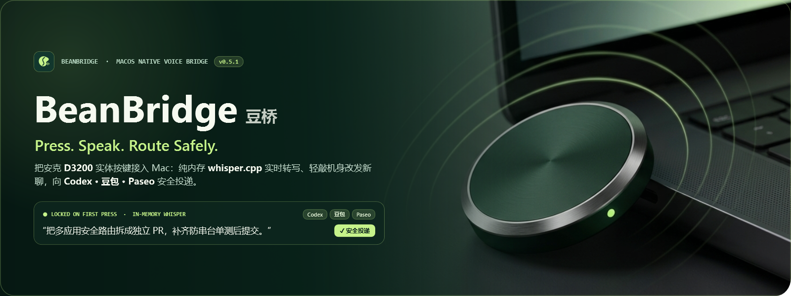
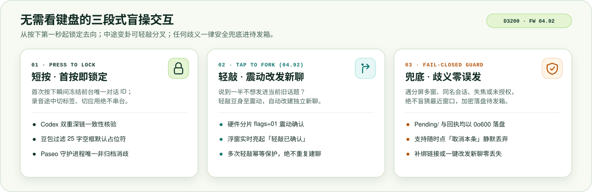
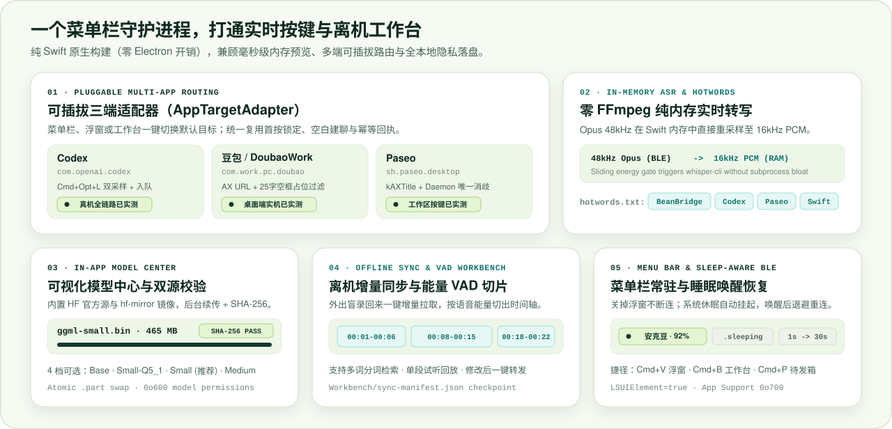
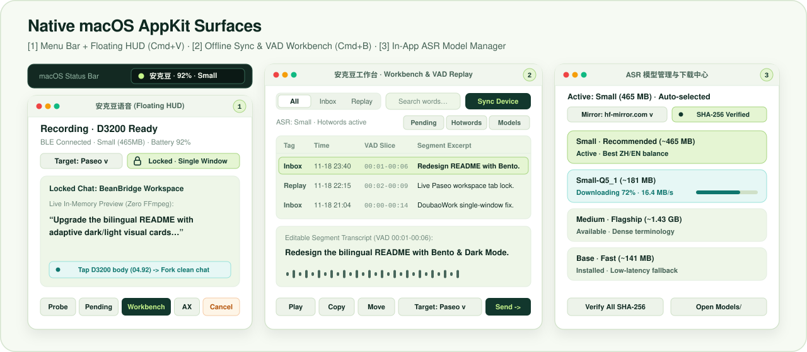
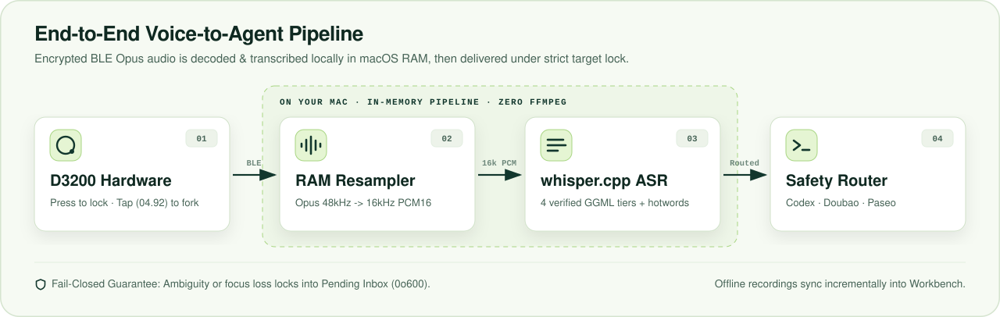
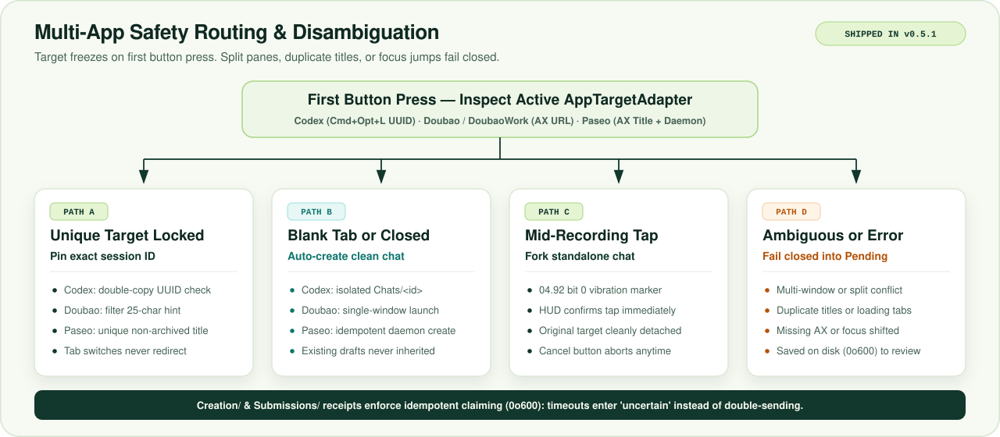
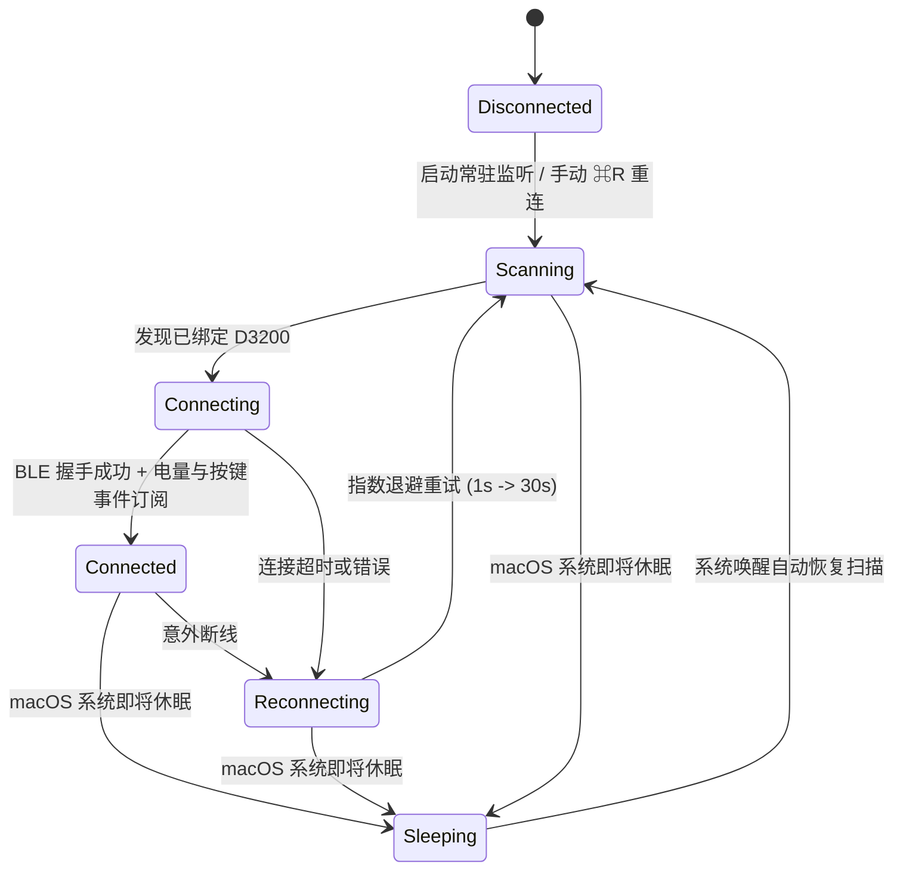

<a id="top"></a>

<p align="center">
  
</p>

<p align="center">
  <b>把 soundcore Work / 安克 AI 录音豆（D3200）接入 Mac，变成 Codex · 豆包 · Paseo 的随身实体语音按键与灵感工作台。</b>
</p>

<p align="center">
  
  
  
  
  
  
</p>

<p align="center">
  <b>简体中文</b> · <a href="README.en.md">English</a>
  &nbsp;&nbsp;|&nbsp;&nbsp;
  <a href="#一镜看懂零键盘语音工作流">动态演示</a> ·
  <a href="#物理交互三定律">物理手势</a> ·
  <a href="#核心能力全景">能力矩阵</a> ·
  <a href="#原生桌面界面与三端接线">界面与接线</a> ·
  <a href="#快速开始">快速开始</a> ·
  <a href="#架构深潜与验证边界">架构与验证</a> ·
  <a href="#常见问题排查-faq">FAQ</a>
</p>

---

## 一镜看懂：零键盘语音工作流

无需切回输入框、无需手碰键盘——**BeanBridge** 通过低功耗蓝牙（BLE）常驻连接安克 D3200，在 macOS 内存中实时解密并重采样 Opus 音频流，经本地 `whisper.cpp` 高精度转写后，精准投递到你按下瞬间锁定的目标 AI 会话中：

<p align="center">
   内存实时预览（切屏防串台）-> 再按精准投递" width="100%" />
</p>

<p align="center">
  <sub>▲ 自动循环演示：<b>① 短按 D3200 冻结前台唯一会话</b> → <b>② 内存 16kHz 实时预览（后台切屏不串发）</b> → <b>③ 再按一次安全投递并触发回复</b></sub>
</p>

---

## 物理交互三定律

<p align="center">
  <picture>
    <source media="(prefers-color-scheme: dark)" srcset="docs/assets/tactile-gestures-dark.svg" />
    <source media="(prefers-color-scheme: light)" srcset="docs/assets/tactile-gestures-light.svg" />
    
  </picture>
</p>

> [!IMPORTANT]
> **首按不可变锁定铁律**：每段语音的投递去向在**首次按下实体键**时就已锁定并显示在浮窗中。录音途中切标签页或切应用不会改投；一旦遇到多窗口分屏冲突、重名标签、失焦或未授权，系统宁可把原话以 `0o600` 权限存入本地 `Pending/` 待发箱，也**绝不盲猜最近活跃对话**。

---

## 核心能力全景

<p align="center">
  <picture>
    <source media="(prefers-color-scheme: dark)" srcset="docs/assets/bento-overview-dark.svg" />
    <source media="(prefers-color-scheme: light)" srcset="docs/assets/bento-overview-light.svg" />
    
  </picture>
</p>

- **可插拔多应用路由（Codex / 豆包 / Paseo）**：基于统一的 `AppTargetAdapter` 协议与 `AppTargetRegistry`，可在菜单栏、浮窗或工作台随时一键切换默认目标客户端，并共享首按锁定、空白自动新建与幂等落盘回执。
- **零 `ffmpeg` 纯内存实时预览 + 专词热词表**：在 Swift 内存中直接完成 `48kHz Opus -> 16kHz PCM` 降采样与滑动能量门控；内置 `hotwords.txt` 热词注入（预置 `BeanBridge`、`Codex`、`豆包`、`Paseo`、`Whisper`、`Swift` 等术语），可在应用内随时编辑生效。
- **应用内 ASR 模型管理与双源下载中心**：支持 `base` / `small-q5_1` / `small` / `medium` 4 档 GGML 模型，内置 **Hugging Face 官方源** 与 **`hf-mirror.com` 镜像源** 切换、实时速度与 ETA、关闭窗口后台续传以及分块流式 SHA-256 校验。
- **蓝牙常驻守护与离机 VAD 灵感工作台**：纯原生 AppKit 构建（`NSStatusItem` 菜单栏常驻，关浮窗不断连），支持 `1s`～`30s` 指数退避重连与 macOS 休眠 `.sleeping` 防抖；外出离机录音回来可一键增量同步、按语音能量自动切片（VAD）、多词搜索试听并一键转发。

<p align="right"><a href="#top">↑ 返回顶部</a></p>

---

## 原生桌面界面与三端接线

### 1. 原生 macOS AppKit 协同面板

<p align="center">
  <picture>
    <source media="(prefers-color-scheme: dark)" srcset="docs/assets/ui-tour-dark.svg" />
    <source media="(prefers-color-scheme: light)" srcset="docs/assets/ui-tour-light.svg" />
    
  </picture>
</p>

<details>
<summary><b>点击展开：各窗口功能分工与全局菜单栏快捷键表</b></summary>

| 界面 / 快捷键 | 核心职责与常用操作 |
|---|---|
| **菜单栏状态项（`NSStatusItem`）** | 实时展示连接状态与电量（`安克豆 92%` / `录音中` / `重连#2` / `休眠`）、当前生效 Whisper 模型及后台下载进度 |
| <kbd>⌘</kbd>+<kbd>V</kbd> **语音浮窗（`安克豆语音`）** | 切换默认目标客户端、查看内存级实时转写预览与锁定会话徽章，执行「检测目标（3 秒切换）」「辅助功能授权」「取消本条」 |
| <kbd>⌘</kbd>+<kbd>B</kbd> **安克豆工作台（`WorkbenchPanel`）** | 一键「增量同步离机录音」，按「全部 / 灵感收集箱 / 工作回放」筛选，空格多词检索，VAD 片段试听回放，在线微调文本并一键发往目标或新建会话 |
| <kbd>⌘</kbd>+<kbd>P</kbd> **待发箱（`Pending`）** | 查看因未聚焦、分屏歧义或超时安全保留的语音原稿；支持粘贴显式对话链接补发，或一键新建独立会话发送 |
| **ASR 模型管理与下载中心** | 从菜单栏或工作台进入；切换 `HF 官方源` / `hf-mirror.com`、查看实时网速与剩余时间、批量校验本地模型 SHA-256、一键打开 `Models/` 目录 |
| **更多捷径** | <kbd>⌘</kbd>+<kbd>R</kbd> 立即重连录音豆 · <kbd>⌘</kbd>+<kbd>Q</kbd> 彻底退出守护进程 |

</details>

### 2. 支持的目标客户端与接线规格

| 客户端 (`appID`) | 支持版本与 Bundle ID | 前台唯一锁定机制 | 自动建聊与投递通路 | 当前验证状态 |
|---|---|---|---|---|
| **Codex** (`codex`) | `com.openai.codex` | 触发 `⌘⌥L` 复制深链并做双采样一致性核验 + `thread/read` 只读校验 | 独立无项目目录 `Chats/<id>` 建聊，`codex queue --thread` 入队 | **D3200 真机全链路已实测通过** |
| **豆包 / DoubaoWork** (`doubao`) | `com.work.pc.doubao` / `com.bot.pc.doubao` / `com.bytedance.doubao` | AX 读取窗口 URL（映射 `chrome://doubaowork-chat/chat`），自动过滤 25 字默认空框提示并保护真实手写草稿 | `scripts/doubao-chat.py` 排他回执 + 单窗口唤醒与焦点提交 | **本机真实 `DoubaoWork.app` 探测、唤醒与发送已实测通过** |
| **Paseo** (`paseo`) | `sh.paseo.desktop` | 直读 `/agent/<id>`；工作区 `/workspace/<id>` 开启 `AXEnhancedUserInterface` 结合 `kAXTitleAttribute` 与本地 Daemon 唯一消歧 | `scripts/paseo-chat.py` + `paseo-daemon-helper.mjs` 幂等建聊，`paseo send --behavior steer` 投递 | **最大化工作区 D3200 按键发送至当前会话已实测通过**；草稿页建聊与轻敲新聊待实测 |

<details>
<summary><b>点击展开：Codex / 豆包工作版 / Paseo 客户端接线细则与可选环境变量</b></summary>

#### 接入 Codex Desktop
- 确保已登录桌面版 Codex（自动发现内置 `CodexCLI.app` 或 `PATH` 中的 `codex`，可用 `BEANBRIDGE_CODEX` 指定路径）。
- 保留默认 `⌘⌥L`「复制聊天深层链接」快捷键（若自定义过按键，可用 `BEANBRIDGE_COPY_KEYCODE` 覆盖 macOS 虚拟键码，默认 `37` 即 `L`）。
- 录音开始时保持单个 Codex 窗口位于前台即可锁定；若客户端未启动或停在空白页，录音结束后将自动创建干净独立会话并唤起桌面端。

#### 接入豆包 / DoubaoWork
- 同时兼容豆包个人版、企业工作版 `DoubaoWork.app` 与字节内版 Bundle ID（可通过逗号分隔的 `BEANBRIDGE_DOUBAO_BUNDLE_ID` 调整优先级）。
- 内置 `CurrentChat.isDoubaoPlaceholderOrEmpty` 过滤器：精准忽略豆包自带的 25 字空框提示文案（`"发消息或创建任务... / 使用技能 @ 添加资料"`），而当你真正在输入框打了草稿时依然安全拦截防覆盖。
- 可选扩展：`BEANBRIDGE_DOUBAO_BRIDGE_CMD` 接入自定义外部提交脚本；`BEANBRIDGE_DOUBAO_AX_SUBMIT=0` 禁用内置 AX 提交。

#### 接入 Paseo
- 同时支持独立会话页（`paseo://h/<serverId>/agent/<id>` / `https://app.paseo.sh/h/<serverId>/agent/<id>`）及最大化/全屏工作区视图（`/h/<serverId>/workspace/<workspaceId>`）。
- 自动过滤 macOS 全屏顶部辅助工具条，提取活动窗格标题向本地 Paseo Daemon 执行 `resolve-workspace-tab` 唯一非归档会话核验。
- **防盲猜拦截**：停在「新建 Agent」/「New tab」草稿页时会在录音结束后自动创建新会话；若工作区内存在同名活跃会话或多窗格分屏冲突，严格转入 `Pending` 待发箱。
- 可选覆盖：`BEANBRIDGE_PASEO_PROVIDER`、`BEANBRIDGE_PASEO_WORKSPACE_ID`、`BEANBRIDGE_PASEO_CWD`、`BEANBRIDGE_PASEO_CLI`。

</details>

<p align="right"><a href="#top">↑ 返回顶部</a></p>

---

## 快速开始

### 第 1 步：准备基础环境

```bash
git clone https://github.com/sup-lh/beanbridge.git
cd beanbridge
brew install whisper.cpp
```

> 主测环境为 Apple Silicon、macOS 26.6.2、Xcode 26.2 / Swift 5.10、`whisper.cpp` 1.9.5（最低支持 macOS 14+）。实时预览已在内存中完成 `48kHz -> 16kHz` 重采样，常规按键使用无需安装 `ffmpeg`。

### 第 2 步：构建并启动应用（可直接应用内下载模型）

```bash
./build-button-app.sh
open "dist/安克豆按键语音.app"
# 或直接双击仓库根目录的「启动按键语音.command」一键构建并启动
```

- **推荐：应用内可视化下载模型**：启动后点击菜单栏 **「ASR 模型管理与下载…」**（或工作台 **「ASR 模型与下载」**），选择 **Hugging Face 官方源** 或 **`hf-mirror.com` 国内镜像源**，推荐下载 **`Small` (~465 MB)** 或 **`Small-Q5_1` (~181 MB)**。
- **备选：命令行预安装模型**：
  ```bash
  ./scripts/setup-model.sh --tier small-q5_1 --set-default
  ```

<details>
<summary><b>展开查看：4 档 Whisper GGML 模型对比与自动优选优先级</b></summary>

| 层级 (`tier`) | 模型文件 | 近似体积 | 推荐场景 |
|---|---|---|---|
| `base` | `ggml-base.bin` | ~141 MiB | 极速响应，适合轻量测试与基础兜底 |
| `small-q5_1` | `ggml-small-q5_1.bin` | ~181 MiB | 量化高性价比，兼顾中英混说准确率与低内存占用 |
| `small` | `ggml-small.bin` | ~465 MiB | **日常主力推荐**，中文与中英技术术语识别稳健 |
| `medium` | `ggml-medium.bin` | ~1.43 GiB | 旗舰精度，适合密集专有名词场景，磁盘与算力开销较高 |

解析优先级：`BEANBRIDGE_MODEL` 环境变量 ＞ `support/model-preference` ＞ 自动优选本地已安装最高档模型（`medium > small > small-q5_1 > base`）＞ 回退 `Models/ggml-base.bin`。

</details>

### 第 3 步：授予权限并按豆开聊

1. **释放手机端蓝牙占用**：首次配对或连接前，先暂时关闭 iPhone 蓝牙（确保手机飞书未抢连 D3200），将录音豆置于空闲状态放在 Mac 旁。
2. **开启蓝牙与辅助功能权限**：允许 macOS **蓝牙**弹窗授权；点击浮窗 **「辅助功能授权」**，在「系统设置 → 隐私与安全性 → 辅助功能」中勾选 **安克豆按键语音**。
3. **验证并开说**：选定默认目标应用，可先点浮窗 **「检测目标」**（3 秒内切回目标窗口做只读探测）；随后 **短按 D3200 说话 → 看浮窗实时预览 → 再短按一次完成投递**！

> [!TIP]
> **重新运行 `./build-button-app.sh` 后提示无辅助功能权限？**
> 本地脚本采用临时签名（`codesign --sign -`），重打包会使旧 TCC 记录失效。执行一次以下命令重置后重新勾选即可：
> ```bash
> tccutil reset Accessibility dev.codex.anker-button-voice
> ```

<p align="right"><a href="#top">↑ 返回顶部</a></p>

---

## 架构深潜与验证边界

### 端到端语音安全路由管线

<p align="center">
  <picture>
    <source media="(prefers-color-scheme: dark)" srcset="docs/assets/flow-dark.svg" />
    <source media="(prefers-color-scheme: light)" srcset="docs/assets/flow-light.svg" />
     内存重采样 -> whisper.cpp -> 多应用安全路由" width="100%" />
  </picture>
</p>

<details>
<summary><b>展开查看：多应用安全路由与歧义消解决策树（Paths A～D）</b></summary>

<br />

<p align="center">
  <picture>
    <source media="(prefers-color-scheme: dark)" srcset="docs/assets/multi-app-routing-dark.svg" />
    <source media="(prefers-color-scheme: light)" srcset="docs/assets/multi-app-routing-light.svg" />
    
  </picture>
</p>

</details>

<details>
<summary><b>展开查看：BLE 断线指数退避与 macOS 休眠唤醒状态机（ReconnectCoordinator）</b></summary>



</details>

### 验证状态与已知边界

我们严格区分**真机硬件端到端实测结论**与**自动化单元测试覆盖范围**：

| 模块 / 场景 | 验证方式 | 当前结论与已知边界 |
|---|---|---|
| D3200 BLE 发现、实时 Opus 解密与 BlackHole 虚拟麦桥 | 真机 D3200 硬件实测 | **已验证通过** |
| Codex 前台锁定、切页防串、冷启动建聊、`04.92` 轻敲改发新会话 | 真机 D3200 实体按键端到端 | **已验证通过**（真实会话收到并触发回复） |
| `DoubaoWork.app` 目标探测、单窗口唤醒与 25 字空框占位发送 | 本机真实 `DoubaoWork.app` 联调 | **已验证通过** |
| Paseo 最大化工作区当前会话锁定与 D3200 按键实时投递 | 真机 D3200 + 本机 `Paseo.app` 端到端 | **已验证通过**（多条语音文字实时送达当前会话）；草稿页自动建聊与轻敲新聊待实测 |
| 应用内 ASR 模型中心（`ggml-small.bin` 465 MB 下载与校验） | 本机 `.app` UI 真机下载 + 离线单测 | **已验证通过**（下载、实时网速、流式 SHA-256 校验与切换正常） |
| BLE 自动重连 / 睡眠唤醒、离机增量同步与 VAD 切片归档 | Swift / Python 自动化测试 + Release 构建 | **49 项 Swift + 16 项 Python 测试全绿**，`verify-release.sh` 通过；**全天休眠续航与海量离线录音积压待硬件长测** |

> [!NOTE]
> 提交回执返回 `queued` 表示文本已安全交付给目标客户端队列或守护进程，最终展示以客户端窗口内实际出现消息为准。任何原始录音与私人对话内容均不会进入 Git 仓库。

<details>
<summary><b>展开查看：高级模式（Dry-Run / Fixed 绑定 / BlackHole 麦克风桥）、持久化目录与环境变量全表</b></summary>

#### 只测试转写不投递（`dry-run`）
```bash
touch "$HOME/Library/Application Support/AnkerVoiceBridge/dry-run"
open "dist/安克豆按键语音.app"
# 恢复正常投递：退出应用后删除该 dry-run 文件
```

#### 固定绑定单一 Codex 会话（`fixed` 模式）
```bash
python3 scripts/set-target.py --thread-id "替换为目标会话 UUID"
printf 'fixed\n' > "$HOME/Library/Application Support/AnkerVoiceBridge/routing-mode"
# 删除 routing-mode 或写回 current 即恢复前台自动锁定；加 --check 可做只读核验
```

#### BlackHole 虚拟麦克风桥（供客户端原生语音按钮直采）
```bash
brew install blackhole-2ch
swift build -c release --product anker-voice-bridge
.build/release/anker-voice-bridge
# 请勿与「安克豆按键语音.app」同时运行；Ctrl-C 退出后自动恢复原系统默认输入（最长 1 小时）
```

#### 本机数据目录与权限模型
`~/Library/Application Support/AnkerVoiceBridge/`（目录权限 `0o700`，敏感配置/模型/回执权限 `0o600`）：
- `target-app` / `model-preference` / `hotwords.txt`
- `Models/` / `Pending/` / `Creation/` / `Submissions/`
- `Workbench/`（`sync-manifest.json` 增量清单、全文索引与 VAD 音频切片）
- `Chats/`（Codex 独立会话工作目录）/ `PaseoVoice/`（Paseo 默认建聊目录）

#### 环境变量覆盖清单（从同一终端启动时生效）
- **路由全局**：`BEANBRIDGE_TARGET_APP`（`codex` / `doubao` / `paseo`）、`BEANBRIDGE_ROUTING`（`current` / `fixed`）、`BEANBRIDGE_COPY_KEYCODE`（默认 `37`）、`BEANBRIDGE_SCRIPTS_DIR`
- **Codex**：`BEANBRIDGE_CODEX`、`BEANBRIDGE_CODEX_BUNDLE_ID`
- **豆包**：`BEANBRIDGE_DOUBAO_BUNDLE_ID`、`BEANBRIDGE_DOUBAO_BRIDGE_CMD`、`BEANBRIDGE_DOUBAO_AX_SUBMIT`（设 `0` 关闭内置 AX 提交）、`BEANBRIDGE_DOUBAO_DIAG=1`
- **Paseo**：`BEANBRIDGE_PASEO_BUNDLE_ID`、`BEANBRIDGE_PASEO_CLI`、`BEANBRIDGE_PASEO_APP`、`BEANBRIDGE_PASEO_HOST`、`BEANBRIDGE_PASEO_HOME`、`BEANBRIDGE_PASEO_PROVIDER`、`BEANBRIDGE_PASEO_CWD`、`BEANBRIDGE_PASEO_WORKSPACE_ID`、`BEANBRIDGE_PASEO_DIAG=1`
- **ASR 与工具链**：`BEANBRIDGE_MODEL`、`BEANBRIDGE_MODEL_BASE_URL`、`BEANBRIDGE_WHISPER`、`BEANBRIDGE_WHISPER_NO_GPU=1`、`BEANBRIDGE_FFMPEG`、`BEANBRIDGE_PYTHON`

</details>

---

## 常见问题排查 (FAQ)

<details>
<summary><b>Q1：系统设置里明明勾选了辅助功能，为什么点「检测目标」仍提示无权限？</b></summary>

每次执行 `./build-button-app.sh` 都会用本机临时证书重签产物，macOS TCC 会把新签名视为不同二进制而使旧勾失效。在终端执行：
```bash
tccutil reset Accessibility dev.codex.anker-button-voice
```
随后重新打开 `dist/安克豆按键语音.app` 并在「系统设置 → 隐私与安全性 → 辅助功能」重新勾选即可。

</details>

<details>
<summary><b>Q2：Paseo 最大化窗口提示「未取得目标」，或出现同名对话时会怎样？</b></summary>

- 若当前停在 **「新建 Agent」/「New tab」** 草稿标签，由于草稿尚无持久会话 ID，只读「检测目标」提示未取得目标属于正常现象——直接**按 D3200 说话**，结束后会自动在该工作区新建独立对话并送达。
- 若同一工作区存在多个完全同名的非归档会话，或处于多 Agent 分屏态，BeanBridge 会严格执行 fail-closed 存入 `Pending` 待发箱，拒绝盲猜；将当前标签改个唯一标题即可，或检查诊断快照 `~/Library/Application Support/AnkerVoiceBridge/paseo-ax-diag.json`。

</details>

<details>
<summary><b>Q3：`DoubaoWork.app` 为什么不会再误判空白输入框有草稿或弹出双窗口？</b></summary>

`v0.5.1` 已专项适配：通过 Bundle ID 单窗口唤醒主程序，不再传入 `doubaowork://` 触发额外 `DoubaoWork Browser.app` 外框；同时自动识别过滤豆包自带的 25 字空框提示，仅在检测到真实手写草稿时才触发防覆盖保护。

</details>

<details>
<summary><b>Q4：中英混说或代码专有名词（如 `AppTargetAdapter`、`Paseo`）怎么进一步提准？</b></summary>

1. 打开菜单栏 **「ASR 模型管理与下载…」**，切换至 **`Small` (~465 MB)** 或 **`Small-Q5_1` (~181 MB)**。
2. 点击 **「编辑专业术语热词表…」**，将高频仓库名、类名或英文缩写写入 `hotwords.txt` 即可即时生效。

</details>

<details>
<summary><b>Q5：手机飞书抢连录音豆，或 Mac 睡眠唤醒后未立刻连上怎么办？</b></summary>

先临时关闭 iPhone 蓝牙释放手机端连接；Mac 唤醒后 `ReconnectCoordinator` 会自动从 `.sleeping` 恢复扫描重连（`1s`～`30s` 退避），也可直接按菜单栏快捷键 <kbd>⌘</kbd>+<kbd>R</kbd> 立即重连。

</details>

---

## 开发测试与目录结构

```bash
swift build -c release
swift test
/usr/bin/python3 -m unittest scripts/test-create-chat.py scripts/test-doubao-chat.py scripts/test-paseo-chat.py
./scripts/verify-release.sh
```

```text
Sources/AnkerButtonVoice/    菜单栏常驻守护、语音浮窗、ASR 服务与热词、模型下载中心、灵感工作台面板
Sources/AnkerVoiceBridge/    BlackHole 虚拟麦克风桥、系统默认输入保存与自动恢复
Sources/AnkerEventProbe/     只读记录 BLE 控制包与 04.92 轻敲分片标记的硬件诊断工具
Sources/OpenBeanKit/         BLE/Opus 协议核心、ASR 模型目录与下载器、退避重连、离机增量同步与 VAD 归档
Sources/VoiceRouting/        AppTargetAdapter 多端抽象、Codex/豆包/Paseo 路由适配、AX 窗口核验、待发箱
scripts/                    模型安装、三端桥接脚本与 Daemon Helper、视觉物料生成器、16 项单测与发布自检
Tests/                      OpenBeanKitTests 与 VoiceRoutingTests（共 49 项 Swift 单元测试）
docs/                       实验手记、上下文路由设计、品牌视觉物料清单与产品演进路线
```

## 致谢与开源许可

- 设备 BLE 通信协议及部分底层 Swift 实现衍生自 [OpenBean](https://github.com/imraywang/openbean)（基准提交 `13968d8ea27ca57fa254bf01c43c13c388f1a696`），详见 [第三方来源说明](docs/third-party.md) 与 [NOTICE-OpenBean](NOTICE-OpenBean)。
- 本仓库源码、文档与原创视觉资产采用 [Apache-2.0](LICENSE) 许可开源；外部安装的 `whisper.cpp`、BlackHole 及语音模型遵循各自原始许可。本项目与 Anker、飞书、OpenAI、字节跳动（豆包）及 Paseo 无官方关联。

<p align="right"><a href="#top">↑ 返回顶部</a></p>
