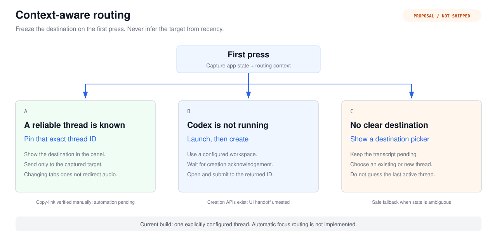

<p align="center">
  
</p>

<h1 align="center">豆桥 · BeanBridge</h1>

<p align="center">给 Codex 对话接上一颗实体语音按钮。</p>
<p align="center"><b>按一下说话 · 看浮窗预览 · 再按一下发送</b></p>
<p align="center">
  <a href="#快速开始">快速开始</a> ·
  <a href="docs/field-notes.md">完整实验记录</a> ·
  <a href="docs/context-routing.md">自动选对话方案</a> ·
  <a href="docs/brand.md">视觉物料</a>
</p>

---

BeanBridge 将 soundcore Work / 安克 AI 录音豆 D3200 通过蓝牙连接到 Mac，在本机完成语音识别，并把最终文字发送到指定的 Codex 对话。你可以离开键盘口述需求，再用录音豆的第二次按键结束这一条消息。

**这是已在一台 Mac、一颗 04.92 固件设备上验证的实验原型。** 固定对话的完整发送链路已成功；自动跟随前台对话、自动启动并创建新对话、后台重连仍属于设计阶段。

## 两种使用方式

| | 按键语音应用 · 推荐 | 虚拟麦克风桥 |
|---|---|---|
| 开始 | 按一次录音豆 | 启动脚本，由程序开始录音 |
| 说话 | 浮窗显示本地识别预览 | 在 Codex 点麦克风输入 |
| 结束 | 再按一次，最终文字自动排队发送 | 终端按 Control-C |
| 识别 | whisper.cpp，在 Mac 本地完成 | 由使用麦克风的应用处理 |
| 发送目标 | 预先绑定的一个 Codex 对话 | 当前由你操作的输入框 |
| 额外依赖 | 本地 Whisper 模型，约 141 MiB | BlackHole 2ch |


音频在本机转写，**最终文字会进入 Codex**，并按你使用的 Codex 账号和模型配置处理。录音豆仍会保存自己的录音，恢复手机连接后可能同步到飞书。

## 已经验证

- [x] D3200 蓝牙发现、握手和实时音频解码。
- [x] 实体按键开始 / 结束，浮窗实时预览。
- [x] 中文短句本地转写，以及最终文字进入指定对话队列。
- [x] 对话实际收到按键助手发送的消息，而不只是显示“已入队”。
- [x] BlackHole 麦克风方式接入 Codex 语音输入。
- [x] 麦克风桥启动时切换输入，正常退出时恢复原输入。

> **当前目标是固定的。** 切换 Codex 窗口或对话不会更改发送目标。第二次按键会自动提交最终识别文字，预览和最终结果可能有差异。

## 快速开始

### 1. 准备环境

实测环境：Apple 芯片、macOS 26.6.2、Xcode 26.2、Codex CLI 0.167.0、whisper.cpp 1.9.5。Swift 包声明最低 macOS 14，但更早系统和 Intel Mac 尚未实测。

需要 Xcode / Swift 开发工具、Python 3、已登录的 Codex，以及以下程序：

```bash
gh repo clone sup-lh/beanbridge
cd beanbridge
brew install ffmpeg whisper.cpp
./scripts/setup-model.sh
```

模型安装脚本核对 SHA-256；若已有正确模型会直接复用。它不会安装 BlackHole，按键模式也不需要 BlackHole。

### 2. 绑定你要发送的对话

在目标 Codex 对话里让代理执行：

```bash
python3 scripts/set-target.py
```

脚本使用该会话提供的 `CODEX_THREAD_ID`，通过只读 `thread/read` 验证后才保存。普通终端不一定有这个环境变量，可以显式指定：

```bash
python3 scripts/set-target.py --thread-id "替换为目标会话的 UUID"
```

`--check` 仅验证，不改配置。目标保存在 `~/Library/Application Support/AnkerVoiceBridge/target-thread`，不在仓库中。更换目标后需重启按键应用。

### 3. 构建并连接

```bash
./build-button-app.sh
open "安克豆按键语音.app"
```

在 iPhone「设置 → 蓝牙」暂时关闭蓝牙，或以其他方式确保手机飞书没有占用录音豆连接。将录音豆放到 Mac 附近，确认它当前没有在录音。保留原有设备绑定即可。

首次运行需要蓝牙权限。如果没有自动弹窗，可在「系统设置 → 隐私与安全性 → 蓝牙」添加 `安克豆按键语音.app`，授权后退出并重新打开。

### 4. 按一下，说话，再按一下

| 步骤 | 你做什么 | 浮窗表现 |
|---|---|---|
| 就绪 | 等待连接成功 | 准备就绪，按一下录音豆 |
| 开始 | 短按一次，等约一秒再说话 | 正在录音，随后出现识别预览 |
| 结束 | 再短按一次 | 正在生成最终文字 |
| 提交 | 无需再点发送 | 已放入 Codex 队列 |

Codex 忙时消息可能等待当前回合结束。**“已放入队列”表示入队成功，不保证模型立即开始处理。** 最终应以目标对话实际出现消息为准。

结束使用时先用实体键停止录音，再关闭浮窗。关闭浮窗会退出应用，但不保证设备本身停止录音。之后可以恢复手机蓝牙。

<details>
<summary><b>只测试识别，不自动发送</b></summary>

关闭应用后运行：

```bash
touch "$HOME/Library/Application Support/AnkerVoiceBridge/dry-run"
open "安克豆按键语音.app"
```

恢复自动发送：关闭应用，删除上述 `dry-run` 标记，再打开应用。

</details>

<details>
<summary><b>使用 BlackHole 虚拟麦克风</b></summary>

这条路径适合继续使用 Codex 自带的麦克风输入。先安装 [BlackHole 2ch](https://github.com/ExistentialAudio/BlackHole)，按安装器要求重启。仓库不附带其安装包。

```bash
brew install blackhole-2ch
swift build -c release --product anker-voice-bridge
.build/release/anker-voice-bridge
```

等待“实时音频已接通”，然后在 Codex 点击麦克风。程序自动开始录音，这时不要再按录音豆按钮。终端按 Control-C 结束；正常退出会恢复启动前的系统输入。如果运行期间你手动换了输入，它会保留你的选择。

异常退出时请检查录音灯及系统输入。程序最长运行一小时；它不是全天录音服务。请勿与按键应用同时运行。

</details>

## 你提出的下一版：跟随当前对话



| 场景 | 计划中的行为 | 当前结论 |
|---|---|---|
| Codex 显示明确的对话 | 首次按键时锁定该对话，第二次按键提交 | **缺少已验证的前台对话来源**；会话列表不代表选中状态 |
| Codex 未运行 | 启动应用，在配置的工作目录创建新对话并发送 | 启动与建会话有接口，完整桌面交付链路还需验证 |
| Codex 在运行但目标不明确 | 弹出选择器，允许选择或新建 | 可实现；尚未加入当前版本 |

设计会在首次按键时固定目标，避免说话期间切换窗口把内容发错。具体接口证据、状态机和验收条件见 [自动选对话可行性](docs/context-routing.md)。

## 限制与排错

- **识别准确度**：当前使用 Whisper base，专有名词、中英混说和短音节可能误听；不要把预览当作最终稿。
- **长度**：按键模式在结束后检查音频，超过 5 分钟不自动发送；这不是录满 5 分钟就自动停录。
- **重连**：应用初次扫描约 5 秒，断线后需重新打开；后台重连、开机启动尚未实现。
- **轻量程度**：空闲时保持 BLE 连接；说话时预览反复启动识别进程，尚未做 CPU、续航和全天压力测试。
- **声音数据**：仓库没有原始录音；程序正常处理完成会清理本机临时音频，崩溃时仍可能残留临时文件。设备录音不会自动删除。
- **权限与签名**：应用是本机临时签名，重新构建可能需要重新授权蓝牙；没有 Apple 公证发布包。
- **发送失败**：失败或超时不盲目重试，避免重复消息；尚无持久待发箱和严格的一次投递保证。

更多故障现象和原因见 [踩坑记录](docs/field-notes.md)。

## 开发与验证

```bash
swift build -c release
swift test
python3 scripts/set-target.py --check
```

程序会查找常见安装目录及 `PATH`。特殊位置可使用 `BEANBRIDGE_FFMPEG`、`BEANBRIDGE_WHISPER`、`BEANBRIDGE_CODEX`、`BEANBRIDGE_MODEL`；通过环境变量配置时应从同一终端直接运行可执行文件，Finder 启动的应用不保证继承终端环境。

```text
Sources/AnkerButtonVoice/    按键事件、预览、本地识别、队列发送
Sources/AnkerVoiceBridge/    音频桥、系统输入切换与恢复
Sources/OpenBeanKit/         改编自 OpenBean 的协议实现
scripts/                    模型安装、对话绑定、视觉物料生成
docs/                       实验记录、产品设想、路由方案、品牌物料
```

## 来源与许可

设备协议及相关 Swift 实现来自 [OpenBean](https://github.com/imraywang/openbean)，基准提交 `13968d8ea27ca57fa254bf01c43c13c388f1a696`。本项目补充了 Codex 队列连接、独立浮窗、音频桥、状态检查、文档及视觉物料。变更范围见 [第三方来源](docs/third-party.md)。

仓库代码、文档及原创图形采用 [Apache-2.0](LICENSE)；上游声明保留在 [NOTICE-OpenBean](NOTICE-OpenBean)。外部安装的 BlackHole、whisper.cpp 和语音模型遵循各自许可。本项目与 Anker、飞书及 OpenAI 无官方关联。
