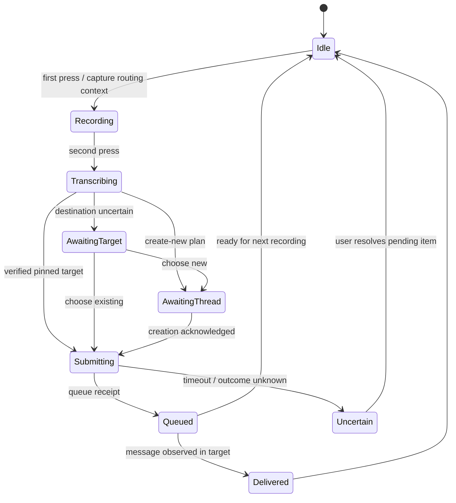

# 按键后自动选择 Codex 对话：可行性与下一版设计

状态：**设计提案，未实现**。核实时间：2026-11-14 至 2026-11-15。当前版本依然发送到显式绑定的固定对话。

## 结论

已经找到明确的工程路径：**通过 Codex 官方“复制聊天深层链接”命令，取得当前对话的真实 ID。** 2026-11-15，用户分别在两个已有对话执行该命令并提交链接；一个 ID 与当前代理会话完全一致，另一个通过只读查询验证为不同的已存在对话。

这证明了“手动取得当前对话 ID，且结果随对话切换”在本机有效。**后台自动触发、焦点竞态、多窗口和无对话页面仍未联测**，因此不能宣称自动路由已完成。现有程序继续采用固定目标。

| 用户场景 | 证据与可实现程度 | 建议行为 |
|---|---|---|
| Codex 正在显示某个对话 | 官方复制链接命令已通过 A/B 对话手动验证；`codex queue --thread` 投递也已实测 | 在首次按键时触发复制命令，确认链接新鲜且窗口未切换后锁定 ID；自动触发待实现 |
| Codex 未运行 | 有启动应用、`thread/start`、`turn/start` 及指定对话深层链接 | 在配置的工作目录创建一次，再打开返回的 ID；完整桌面生命周期待联测 |
| Codex 打开但没有明确目标 | 可用自己的选择器收集目标，避免猜测 | 本地保留待发文字，提示选择现有对话或新建 |

“当前显示”必须有明确语义：Codex 的前台主窗口、该窗口实际选中的对话、以及这个观察的时间。Codex 在后台、只有侧栏、显示设置页、多个窗口冲突时，都按目标不明确处理。

## 已核对的接口边界

### 发送到明确 ID：已验证

本机 CLI 0.167.0 支持 `codex queue --thread <ID> --message <TEXT>`。本项目通过参数数组调用，没有把识别文字拼进 shell。消息会进入目标会话队列，运行中的会话可能等待当前回合结束。

CLI `--resume` 不等价于“把桌面切到这个对话”，也不能假定它能接管桌面自己的 app-server。需要分别验证会话归属、运行状态与界面展示。[CLI 实现](https://github.com/openai/codex/blob/main/codex-rs/tui/src/session_queue_commands.rs)

### 当前前台对话：官方复制命令已经手动验证

本次查看的本地生成协议，以及桌面会话列表结果，没有 `focusedThreadId` 或等价的界面选择字段。列表包含 ID、标题、状态和更新时间；这些信息不表示窗口正在显示哪一项。`thread/loaded/list` 也只是内存中已加载的会话。[官方说明](https://learn.chatgpt.com/docs/app-server)

`CODEX_THREAD_ID` 表示正在执行当前代理工具的会话，不会随着用户切换桌面窗口自动变化。根据更新时间、正在运行状态、窗口标题或剪贴板里的旧值去猜目标都不可靠。

Codex 会话内可调用的 `create_thread`、导航等工具不等于第三方常驻程序可以调用的公共本地服务。限定在原生语音聊天中使用的屏幕上下文工具，也不能当作这个后台程序的通用接口。本次未绕过应用界面访问限制。

不过，官方桌面命令文档提供了另一条明确入口：macOS 的 **Command + Option + L（⌘⌥L）** 对应 “Copy chat deep link”，产生 `codex://threads/<thread-id>`。[官方快捷键与深层链接说明](https://learn.chatgpt.com/docs/app/commands)

本次人工验证：

| 操作 | 核对结果 |
|---|---|
| 用户在对话 A 按 ⌘⌥L 并粘贴链接 | 解析出的 UUID 与当前代理的真实 `CODEX_THREAD_ID` 一致 |
| 用户切到另一个已有对话 B，再按 ⌘⌥L | 得到不同 UUID，通过只读 `thread/read` 验证对话存在；未更改目标配置或向 B 发送内容 |

这是直接取出应用生成的标识，不是按标题猜测。出于隐私，A/B 的真实 ID 和对话标题未写入仓库。验证由用户手动操作，后台程序没有模拟快捷键，也没有绕过本会话对 Codex 自身界面的控制限制。

### 如何把复制命令变成可靠的自动路由

这是后续实现规范，尚未加入代码：

1. 首次按键时确认前台是 Codex，记录对应窗口；若应用在后台或没有明确主窗口，转入选择流程。
2. 经用户允许的系统自动化入口触发官方复制命令。默认快捷键可能被用户修改，需支持配置；本次工具环境不允许直接操作 Codex 界面，因此未实测这一步。
3. 只接受这次动作之后的新剪贴板变更，拒绝复用旧链接。必须是支持的本地聊天深层链接，并通过只读查询校验 ID。
4. 获取前后核对窗口与焦点。发生切换、拿不到链接、复制的是其他内容或目标不可访问，都停止自动投递并提示选择。
5. 锁定本段录音的目标，浮窗显示目标标题。第二次按键只向该 ID 投递；录音中切换对话不改变目标。
6. 临时保存的原剪贴板内容不记日志、不落盘；仅在剪贴板仍是本程序刚取得的值时恢复，避免覆盖用户新复制的内容。

这条路径能解决实际需求，但它依赖前台命令和权限，可靠性需要通过多窗口、快速切换、快捷键冲突等实测建立。一个“读取当前窗口对话”的专门接口仍会更直接，但当前不必等待它才能继续设计原型。

### 创建新会话：接口可用，桌面衔接待测

官方 app-server 提供初始化、`thread/start`、`turn/start` 和事件流；创建响应给出真实会话 ID。协议并不自动保证独立 app-server 创建的会话立即显示在桌面主窗口。[官方文档](https://learn.chatgpt.com/docs/app-server)

官方也支持 `codex://threads/<thread-id>` 打开指定本地对话，以及 `codex://threads/new` 新建聊天入口。`prompt=` 参数仅预填输入框，**不会自动发送**，不能替代创建回执和投递流程。[官方深层链接说明](https://learn.chatgpt.com/docs/app/commands)

后台程序必须保持新会话的服务生命周期，处理必要的权限请求，不能发出创建请求后立刻退出。桌面接管、导航、账户配置和已有活跃写入者之间的关系属于联测范围。

## 推荐状态机

1. **首次按键锁定目标计划。** 记录目标的来源、观察时间、窗口标识及对话 ID；目标只能来自可靠宿主事件或用户显式选择。
2. **未运行时先唤起应用。** 非空最终稿出来后才新建对话，减少空录音产生空白聊天。新建使用预先设置的工作目录，而不是随意选择主目录或最近项目。
3. **第二次按键结束录音和预览。** 对完整片段生成最终文字；预览不作为不可修改的最终稿。
4. **先回执、再投递。** 新建必须等到会话 ID；提交必须有消息 UUID，并记录“待发送 / 已入队 / 已出现 / 处理失败”等不同状态。
5. **录音期间切换窗口不改目的地。** 浮窗始终显示实际目标，避免用户说到一半切换页面导致误投。

多个窗口、连接断开、应用退出、工作目录缺失、登录失效和目标归档，都进入明确的待处理状态，不回退到“最近一个会话”。结果未知的超时先查询回执，不能盲目重发。

## 怎样保持后台轻量

- 常驻的是 BLE 连接与按键监听；没有按键录音时不运行 ASR。
- 从初始扫描升级为有限退避的重连，睡眠恢复后重新确认设备状态；让手机应用可以主动接管。
- 推理引擎可以复用模型进程，减少目前每次预览的进程启动和模型加载。
- 预览使用有界滑动窗口，最终稿按片段落盘和处理；长录音不一直堆进内存。
- 菜单栏显示设备、目标和发送状态；启动项由用户选择启用。

这里的“轻量”是设计目标，目前没有 CPU、功耗、续航或长时间稳定性基准。

## 最小验收

1. A 对话录音，过程中切换到 B；最终只向 A 投递一次。
2. 多窗口和未选中对话时出现选择器，无默认猜测。
3. Codex 完全退出后按键，启动、选定工作目录、创建、显示、接收一次消息。
4. 创建失败不丢文字，超时不重复建聊或重复发送。
5. 蓝牙断开、系统睡眠及手机抢占连接后状态可理解、可恢复。
6. 保持空闲一段时间不会自行录音、发送或持续运行 ASR。

下一步可以围绕官方复制命令做一个只读目标探针：只显示获取到的目标、不发消息。通过焦点和多窗口测试后，再接入已经验证的录音与队列发送。显式选择器作为无法确定目标时的回退方式。
