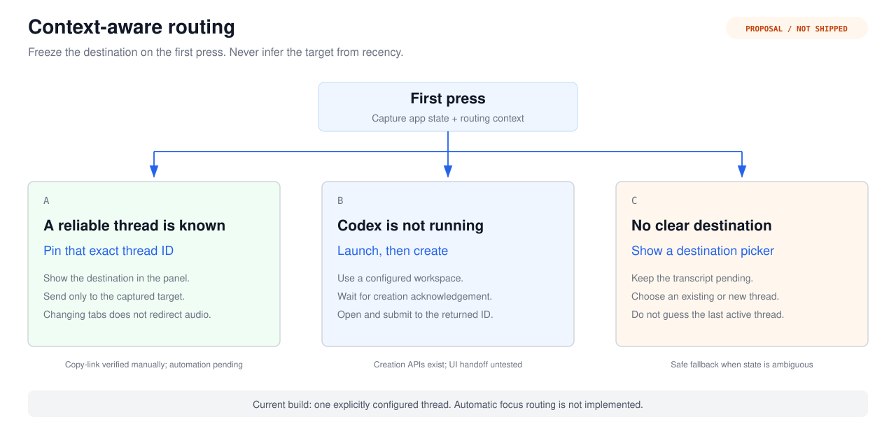
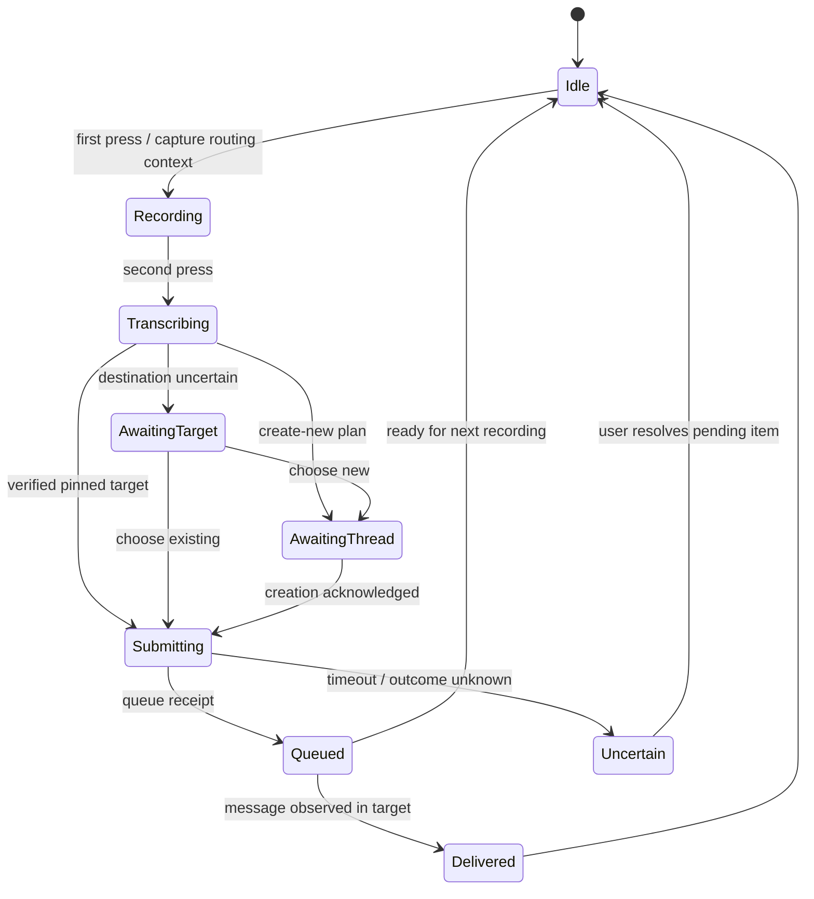

# 按键后自动选择 Codex 对话：可行性与下一版设计

状态：**设计提案，未实现**。核实时间：2026-11-14 至 2026-11-15。当前版本依然发送到显式绑定的固定对话。

## 结论

用户提出的三分支可以作为下一版产品行为。但其中“自动取得桌面当前显示的对话 ID”仍缺少已验证、能供独立后台程序调用的可靠接口。启动应用、创建会话、发起回合有现成能力；把新会话显示到正确桌面窗口、保留账号与项目设置，仍需要完整联测。

| 用户场景 | 证据与可实现程度 | 建议行为 |
|---|---|---|
| Codex 正在显示某个对话 | `codex queue --thread` 的投递已经真机验证；**屏幕当前目标的来源尚未验证** | 只有可靠取得窗口与对话 ID 后，才自动绑定它 |
| Codex 未运行 | 本机 `codex app [PATH]` 可启动应用；官方 app-server 支持 `thread/start` 与 `turn/start` | 启动应用，在用户已配置的工作目录新建一次，得到 ID 后再发送；桌面展示仍需验证 |
| Codex 打开但没有明确目标 | 可用自己的选择器收集目标，避免猜测 | 本地保留待发文字，提示选择现有对话或新建 |

“当前显示”必须有明确语义：Codex 的前台主窗口、该窗口实际选中的对话、以及这个观察的时间。Codex 在后台、只有侧栏、显示设置页、多个窗口冲突时，都按目标不明确处理。

## 已核对的接口边界

### 发送到明确 ID：已验证

本机 CLI 0.167.0 支持 `codex queue --thread <ID> --message <TEXT>`。本项目通过参数数组调用，没有把识别文字拼进 shell。消息会进入目标会话队列，运行中的会话可能等待当前回合结束。

CLI `--resume` 不等价于“把桌面切到这个对话”，也不能假定它能接管桌面自己的 app-server。需要分别验证会话归属、运行状态与界面展示。[CLI 实现](https://github.com/openai/codex/blob/main/codex-rs/tui/src/session_queue_commands.rs)

### 当前前台对话：未找到可用的公开字段

本次查看的本地生成协议，以及桌面会话列表结果，没有 `focusedThreadId` 或等价的界面选择字段。列表包含 ID、标题、状态和更新时间；这些信息不表示窗口正在显示哪一项。`thread/loaded/list` 也只是内存中已加载的会话。[官方说明](https://learn.chatgpt.com/docs/app-server)

`CODEX_THREAD_ID` 表示正在执行当前代理工具的会话，不会随着用户切换桌面窗口自动变化。根据更新时间、正在运行状态、窗口标题或剪贴板去猜目标都不可靠。

Codex 会话内可调用的 `create_thread`、导航等工具不等于第三方常驻程序可以调用的公共本地服务。限定在原生语音聊天中使用的屏幕上下文工具，也不能当作这个后台程序的通用接口。本次未绕过应用界面访问限制。

这是一个**有边界的未验证结论**，不是证明 Codex 永远不可能提供这种能力。未来如增加受支持的焦点事件或宿主集成，可实现这一分支。

### 创建新会话：接口可用，桌面衔接待测

官方 app-server 提供初始化、`thread/start`、`turn/start` 和事件流；创建响应给出真实会话 ID。协议并不自动保证独立 app-server 创建的会话立即显示在桌面主窗口。[官方文档](https://learn.chatgpt.com/docs/app-server)

后台程序必须保持新会话的服务生命周期，处理必要的权限请求，不能发出创建请求后立刻退出。桌面接管、导航、账户配置和已有活跃写入者之间的关系属于联测范围。

## 推荐状态机

1. **首次按键锁定目标计划。** 记录目标的来源、观察时间、窗口标识及对话 ID；目标只能来自可靠宿主事件或用户显式选择。
2. **未运行时先唤起应用。** 非空最终稿出来后才新建对话，减少空录音产生空白聊天。新建使用预先设置的工作目录，而不是随意选择主目录或最近项目。
3. **第二次按键结束录音和预览。** 对完整片段生成最终文字；预览不作为不可修改的最终稿。
4. **先回执、再投递。** 新建必须等到会话 ID；提交必须有消息 UUID，并记录“待发送 / 已入队 / 已出现 / 处理失败”等不同状态。
5. **录音期间切换窗口不改目的地。** 浮窗始终显示实际目标，避免用户说到一半切换页面导致误投。

多个窗口、连接断开、应用退出、工作目录缺失、登录失效和目标归档，都进入明确的待处理状态，不回退到“最近一个会话”。结果未知的超时先查询回执，不能盲目重发。

## 怎样保持后台轻量

- 常驻的是 BLE 连接与按键监听；没有按键录音时不运行 ASR。
- 从初始扫描升级为有限退避的重连，睡眠恢复后重新确认设备状态；让手机应用可以主动接管。
- 推理引擎可以复用模型进程，减少目前每次预览的进程启动和模型加载。
- 预览使用有界滑动窗口，最终稿按片段落盘和处理；长录音不一直堆进内存。
- 菜单栏显示设备、目标和发送状态；启动项由用户选择启用。

这里的“轻量”是设计目标，目前没有 CPU、功耗、续航或长时间稳定性基准。

## 最小验收

1. A 对话录音，过程中切换到 B；最终只向 A 投递一次。
2. 多窗口和未选中对话时出现选择器，无默认猜测。
3. Codex 完全退出后按键，启动、选定工作目录、创建、显示、接收一次消息。
4. 创建失败不丢文字，超时不重复建聊或重复发送。
5. 蓝牙断开、系统睡眠及手机抢占连接后状态可理解、可恢复。
6. 保持空闲一段时间不会自行录音、发送或持续运行 ASR。

先做显式选择目标的菜单栏版本，再在可靠焦点接口可用后加入自动跟随，是目前可控的推进路线。
